# Mil Capivaras

[English](README.md) · [Português](README.pt-BR.md) · **Español**

**Mil Capivaras** es un emulador del **Casio PV-1000** (1983) escrito en **Rust**. Fue
reimplementado a partir del core de MiSTer FPGA y validado cuadro a cuadro contra la
simulación de ese hardware. Ejecuta los **13 cartuchos lanzados** y **26 homebrews de
PV-1000** (22 de Inufuto, los demás de joe_k, KashtPR y Péricles S.), con interfaz gráfica
completa:
- biblioteca con carátulas;
- save states y rebobinado;
- grabación en GIF y MP4;
- depurador y trucos;
- 3 idiomas.

También viene como **core libretro**, para RetroArch.

**Hecho con IA:** el código y esta documentación se escribieron con Claude Code (modelo
Claude Opus 5.5), con dirección, pruebas y revisión del autor.

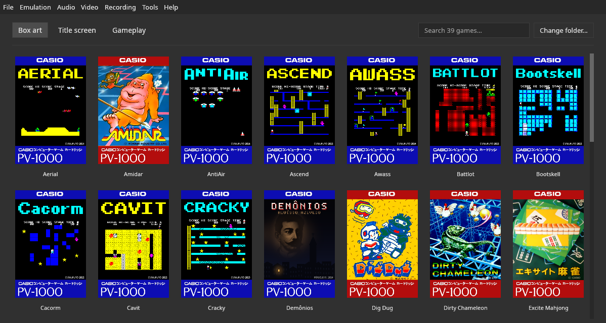

**¿Por qué "Mil Capivaras"?** El nombre une las dos partes del nombre de la consola:
- **Mil** es "1000" en portugués (y también en español);
- **CaPiVara** (carpincho o capibara, en portugués) tiene, en orden, las letras **C**, **P**
  y **V**: **C** de **C**asio y **PV** de **PV**-1000.

Este documento es a la vez el manual del emulador y una referencia técnica de la
consola. Todo lo que aparece aquí salió del código, de mediciones o de las fuentes listadas
en [Referencias](#13-referencias). Donde las fuentes discrepan, la divergencia se indica.

| | |
|---|---|
| Precisión | **Alta** en la escala de la Emulation General Wiki: imagen **idéntica píxel a píxel** al core de MiSTer simulado en todos los cuadros probados, y RAM **idéntica byte a byte** en el cuadro 3000, en todos los juegos probados; el sonido sigue la documentación del hardware real, una octava por debajo de MiSTer ([sección 9](#9-precisión-y-validación)) |
| Compatibilidad | 13/13 juegos comerciales y 26/26 homebrews: imagen y RAM idénticas a la referencia en el cuadro 3000 ([sección 10](#10-compatibilidad)) |
| Velocidad | ~7.400 cuadros/s en un Ryzen 7 8700G (~125× el tiempo real) |
| Plataformas | Linux (Wayland y X11, AppImage), Windows y FreeBSD; core libretro para RetroArch en Linux, Windows y FreeBSD |
| Licencia | GPL-3.0 o posterior ([`LICENSE`](LICENSE)) |

---

## Índice

1. [El Casio PV-1000](#1-el-casio-pv-1000)
2. [Hardware en detalle](#2-hardware-en-detalle)
3. [Cómo difieren las implementaciones](#3-cómo-difieren-las-implementaciones)
4. [Funciones del emulador](#4-funciones-del-emulador)
5. [Instalación y uso](#5-instalación-y-uso)
6. [Arquitectura del código](#6-arquitectura-del-código)
7. [Cómo funciona la emulación](#7-cómo-funciona-la-emulación)
8. [El porqué de cada decisión](#8-el-porqué-de-cada-decisión)
9. [Precisión y validación](#9-precisión-y-validación)
10. [Compatibilidad](#10-compatibilidad)
11. [Core libretro (RetroArch)](#11-core-libretro-retroarch)
12. [Lecciones aprendidas](#12-lecciones-aprendidas)
13. [Referencias](#13-referencias)
14. [Licencias](#14-licencias)

---

## 1. El Casio PV-1000

### Historia

- **Lanzamiento:** octubre de 1983, solo en Japón, por **¥14.800** [W1][W2]. Salió el mismo
  mes que el **PV-2000** ("Rakugaki"), el modelo más caro de Casio. Los dos son
  plataformas distintas, sin compatibilidad de software [W2].
- **Competencia:** competía en precio con la **Famicom** de Nintendo y la **SG-1000** de
  Sega, lanzadas el mismo año y en la misma franja de precio, pero no se acercó a sus
  ventas [W2]. No hay cifras de ventas publicadas.
- **Fin:** fue retirada del mercado en menos de un año. Según retrogames.co.uk, salió
  de las tiendas en pocas semanas por vender poco [W1]. La Wikipedia en japonés señala
  también el paso de Casio al **MSX** (el PV-7, de 1984) [W2].
- **Sucesor:** en la línea de consolas de Casio, la siguiente fue la **Loopy** (1995) [W1].
- **Biblioteca:** **13 cartuchos**, numerados de GPA-101 a GPA-115. Los números
  **GPA-108** y **GPA-113** quedaron vacantes y nunca se lanzaron; se especula que
  serían *Galaga* y *Front Line*, que salieron en el PV-2000 [W1]. La lista de MAME anota
  "GPA-113: Front Line?" [M2].
- **Mando:** venía con un joystick con forma de palanca de avión de caza [W2], el
  **TJ-1**. En la foto de Evan-Amos (Wikimedia Commons), tiene un botón rojo en la parte
  superior de la palanca y los botones Start y Select en la base.

### La biblioteca

Los 13 juegos, con el código del cartucho y el origen, según la lista de software de MAME
[M2] y las Wikipedias [W1][W2]:

| Cartucho | Juego | Año | Origen |
|---|---|---|---|
| GPA-101 | Pooyan (プーヤン) | 1982 | Konami (arcade, 1982) |
| GPA-102 | Super Cobra (スーパーコブラ) | 1981 | Konami (arcade, 1981) |
| GPA-103 | Tutankham (ツターンカーム) | 1982 | Konami (arcade, 1982) |
| GPA-104 | Amidar (アミダー) | 1982 | Konami (arcade, 1981) |
| GPA-105 | Dig Dug (ディグダグ) | 1982 | Namco (arcade, 1982) |
| GPA-106 | Warp & Warp (ワープ&ワープ) | 1981 | Namco (arcade, 1981) |
| GPA-107 | Turpin (ターピン) | 1981? | Konami (arcade "Turtles", 1981) |
| GPA-109 | Pachinko-UFO (パチンコUFO) | 1982 | original de Casio [W2] |
| GPA-110 | Fighting Bug (ファイティング バグ) | 1982 | Universal (arcade "Lady Bug", 1981) |
| GPA-111 | Space Panic (スペースパニック) | 1981? | Universal (arcade, 1980) |
| GPA-112 | Naughty Boy (ノーティーボーイ) | 198? | Jaleco (arcade, 1982) |
| GPA-114 | Dirty Chameleon (ダーティー カメレオン) | 198? | Jaleco [W2] |
| GPA-115 | Excite Mahjong (エキサイト麻雀) | 1982 | original de Casio, el último lanzado [W2] |

La columna "Año" es la de MAME, incluidos sus signos de interrogación. La editora de todos es
Casio.

**Homebrews:** el desarrollador japonés **Inufuto** publica juegos nuevos para decenas de
máquinas de 8 bits, incluido el PV-1000, con ROMs gratuitas en el sitio de Inufuto [I1]
y, para 12 de los juegos de PV-1000, el código fuente. Son **22 títulos para PV-1000** (lista completa en la [sección 10](#10-compatibilidad)).
MAME cataloga 19 de ellos [M2]. Otros autores también hicieron homebrews de PV-1000: PVong
(joe_k), Simon (KashtPR), Demônios y la PV-1000 Control Test (Péricles S.).

---

## 2. Hardware en detalle

Esta sección describe la consola **tal como la implementa el core de MiSTer**, que es la
especificación que sigue Mil Capivaras. Fue cotejada con MAME y Obentou
([sección 3](#3-cómo-difieren-las-implementaciones)). No existe documentación oficial
publicada del chip de video y sonido: el autor del core dice que lo hizo "basándose en MAME, en
videos y a fuerza bruta" [F1]. Las partes sobre la **consola misma** (la placa, el cuadro,
el circuito del mando, el conector) vienen de las mediciones de NESdev [N1]–[N7].

### Especificación

| Componente | Detalle | Fuente |
|---|---|---|
| CPU | Zilog **Z80** (NEC D780C-1, compatible con Z80A) a **3,579545 MHz** | [W1][W2] |
| Video y sonido | chip personalizado **NEC D65010G031** | [W1][W2][F1] |
| RAM | **2 KB** en 0xB800–0xBFFF, compartida entre CPU y video | [W1]; medido |
| Cartucho | ROM de **8 KB o 16 KB** en 0x0000 (hasta 32 KB direccionables) | MAME [M2]; medido |
| Imagen | mapa de **32×24 tiles** de 8×8 píxeles = 256×192; visibles **224×192** (28 columnas) | [W1]; core [C1] |
| Colores | **8** (RGB de 1 bit por componente) | [W1][W2] |
| Patrones | 256 por banco; los tiles 0xE0–0xFF pueden venir de la RAM (**PCG**, 32 patrones) | core [C1] |
| Sonido | **3 canales de onda cuadrada**, período de 6 bits | [W1] |
| Mando | 2 puertos; joystick + 2 botones de disparo + Select + Start, leídos en una matriz | core [C1] |
| Cuadro | **59,538 Hz** (263 líneas de 381 píxeles) en el core; **59,299 Hz** (262 líneas de 288 píxeles) en la consola | core [C1]; [N4] |

**Divergencias entre las fuentes:**
- **RAM:** la Wikipedia en japonés habla de "RAM 3 KB, VRAM 16 KB" [W2]; la en inglés, de
  2 KB compartidos [W1]. El core y los 35 juegos probados usan los 2 KB de
  0xB800–0xBFFF (solo Battlot escribe también por encima de 0xDC00, donde nada responde). Los "16 KB" probablemente cuentan la ROM de patrones del cartucho.
- **Resolución:** la Wikipedia en inglés dice 224×192 en el texto y 240×192 en la ficha [W1]; la
  japonesa, 240×192 [W2]. En el core de MiSTer el área visible va del hc 17 al 239, es decir,
  **223 píxeles** más 1 columna negra (224), sin las 2 columnas de tiles de cada lado.
- **Borde:** en el aparato real, el borde de color que usan algunos juegos queda **arriba y
  abajo**. MAME lo ponía a los lados hasta la versión 267; el autor del core lo verificó en videos
  de la consola real [F1].

### La placa y el chip

Dentro de la consola hay poca cosa [N1]: el **Z80**, una **SRAM de 2 KB**, el chip
personalizado, algo de lógica discreta, un **cristal de 17,897727 MHz** y la parte
analógica (video y sonido).

- **El chip** es un *gate array* de NEC, del servicio µPD65010 de CMOS de 3 µm, con
  1368 × 2 transistores de cada tipo (n-MOS y p-MOS). El número completo, **D65010G031**,
  indica el pedido número 31 en ese formato: encapsulado QFP de 64 pines, 20 × 14 mm [N1].
- **Los pines cuentan cómo funciona** [N6]:
  - **video digital:** salidas separadas de rojo, verde y azul (1 bit cada una), más
    sincronismo compuesto y *colorburst*. El color NTSC se arma fuera del chip;
  - **sonido analógico por fuera:** cada canal cuadrado sale por un pin propio (8, 9 y
    10) y los tres se suman con resistencias en la placa. De ahí los volúmenes distintos
    de cada canal;
  - **bus:** el chip le pide el bus al Z80 con **/BUSRQ** y espera el **/BUSACK** para
    leer la RAM durante la imagen (ver [Un cuadro en la consola](#un-cuadro-en-la-consola));
  - **mandos:** el puerto FD maneja 4 pines de salida (52–55) y lee 4 de entrada (60–63),
    conectados directamente a los dos puertos de mando. Por el contexto de la placa, los
    pines 50 y 51 serían dos salidas más, cortadas en una revisión.
- **Relojes a partir del cristal:** el Z80 recibe cristal ÷ 5 (3,579545 MHz), el píxel es
  cristal ÷ 4 (4,47 MHz) y el sonido cuenta a cristal ÷ 2 [N2][N4].

### Relojes

Todo deriva de un oscilador de **71,590909 MHz** (20 × la frecuencia de color NTSC):

| Señal | Divisor | Frecuencia | Uso |
|---|---|---|---|
| `clk_sys` | 1 | 71,590909 MHz | máquina de estados del video en la FPGA |
| `clk_snd` | ÷4 | 17,897727 MHz | generador de sonido |
| `clk_cpu` | ÷20 | **3,579545 MHz** | Z80 |
| `clk_vdp` | ÷12 | 5,965909 MHz | 1 píxel por ciclo |

- **Línea:** 381 píxeles (hc 0..380) = 63,86 µs = **228,6 ciclos de CPU**.
- **Cuadro:** 263 líneas (vc 0..262) = 100.203 píxeles = **60.121,8 ciclos de CPU** =
  **71.590.909 / 1.202.436 ≈ 59,538 cuadros/s**. No son 60, y Mil Capivaras lo mantiene
  (ver [sección 8](#8-el-porqué-de-cada-decisión)).

### Un cuadro en la consola

El core de MiSTer usa otra temporización (arriba). En la consola, según las mediciones de
NESdev [N4][N6][N7], el cuadro tiene **288 píxeles × 262 líneas**:

| Magnitud | Valor |
|---|---|
| Píxel | cristal ÷ 4 = **4,474 MHz**, proporción **48:35** (más ancho que alto) |
| Línea | 288 píxeles = **230,4 ciclos de Z80**; 15.536 líneas/s |
| Cuadro | 262 líneas = **60.364,8 ciclos**; **59,299 cuadros/s** |

**En horizontal** (píxel 0 = inicio del sincronismo):

| Píxeles | Tramo |
|---|---|
| 0–21 | sincronismo horizontal |
| 22–35 | *colorburst* |
| 36–51 | negro (*back porch*) |
| **52–275** | **224 píxeles**: imagen en las líneas activas, color del borde en las de borde |
| 276–287 | negro (*front porch*) |

**En vertical** (línea 0 = primera línea de imagen):

| Líneas | Cuántas | Tramo |
|---|---|---|
| **0–191** | 192 | **imagen** (tiles) |
| 192–217 | 26 | borde inferior |
| 218–220 | 3 | apagado |
| 221–223 | 3 | sincronismo vertical |
| 224–235 | 12 | apagado |
| 236–261 | 26 | borde superior |

```
línea   0 ┌────────────────────────────────┐  ◄ imagen: el chip toma el bus
          │ 192 líneas de tiles            │    del píxel 20 al 267 de cada línea
      191 │                                │
      192 ├────────────────────────────────┤
          │ 26 líneas de borde             │  ◄ 195: 1.ª IRQ de la matriz, luego 1 cada 4 líneas
      217 ├────────────────────────────────┤
          │ 3 apagadas · 3 de sincronismo  │
          │ vertical · 12 apagadas         │
      236 ├────────────────────────────────┤
          │ 26 líneas de borde             │  ◄ 255: 16.ª IRQ de la matriz e IRQ de prerrenderizado
      261 └────────────────────────────────┘
```

**El robo de bus.** El chip y la CPU comparten el mismo bus. En cada una de las 192
líneas de imagen, el chip mantiene **/BUSREQ** del píxel 20 al 267 (248 píxeles): el Z80
se detiene, y cada 8 píxeles el chip busca en la RAM el número del tile y los 3 bytes de
color [N4][N6]. Las cuentas:

| | Ciclos de Z80 | Libres para el juego |
|---|---|---|
| Línea de imagen | 230,4, de los cuales hasta **198,4 detenidos** | **32 a 37** |
| Cuadro entero | 60.364,8 | **22.272 a 23.232 (37–38 %)**: 6144 a 7104 en las líneas de imagen + 16.128 en las otras 70 |
| Pantalla apagada (bit 3 del puerto FF) | 60.364,8 | todos: el chip no busca nada y el Z80 va más rápido |

Es decir: **con la imagen encendida, el juego tiene poco más de un tercio del Z80.** El
rango de 32 a 37 ciclos se debe a que el Z80 solo cede el bus al inicio de un ciclo de
máquina: la instrucción en curso todavía avanza hasta 5 ciclos después del pedido [N7]. Eso
convierte el tiempo de las líneas de borde, justo después de las interrupciones, en el más
valioso del cuadro.
El modelo de hardware de Mil Capivaras emula este robo
([sección 7](#el-cuadro-en-el-modelo-de-hardware-real)).

**Encender la imagen en medio de una línea** dibuja de 8 a 16 píxeles de basura, de origen
desconocido [N2][N6].

**La imagen casi no cabe en la TV.** Los 224 píxeles ocupan 50,06 µs, **el 96 % de la línea
NTSC** (52,15 µs). Las consolas de la época rondaban el 92 % (NES, Master System, Mega
Drive), y los televisores domésticos mostraban como mucho un 92 %: en la práctica **se
pierden unos 8 píxeles de cada lado en el overscan** [N7]. Por eso MAME recorta los lados
desde la versión 268, a propósito. Mil Capivaras muestra los 224 píxeles enteros con las
dos opciones de imagen.

**Por qué SRAM.** Fuera de la imagen, el chip pasa 70 líneas sin leer la memoria: 4,5 ms.
Una DRAM tendría que aguantar ese tiempo sin refresco; la del SG-1000 (MB8118-12), por
ejemplo, solo está garantizada por 2 ms [N7].

### Notas de quienes programan la consola

Del hilo del foro de NESdev donde se estudió el hardware [N7]:
- **Puerto FE con valores bajos:** escribir de 0 a 3 hace que el chip lea el mapa de tiles
  de la **ROM**, en 0x0000–0x02FF, y el PCG de 0x0C00–0x0FFF. El mapa puede empezar en
  cualquier bloque de 1 KB dentro de un bloque de 4 KB, pero el PCG queda siempre en el
  último 1 KB de ese bloque (con 0xB8: mapa en 0xB800, PCG en 0xBC00).
- **Latencia de la interrupción:** del pedido al efecto visible en el manejador (cambiar el
  color del borde) pasan **55 ciclos**, unos 70 píxeles.
- **Interrupción sin reconocer:** con las interrupciones de la CPU activas, un manejador que
  no reconoce la de prerrenderizado (escribiendo en el puerto FD) se vuelve a llamar para
  siempre.
- **Cuándo ejecutar la lógica del juego:** en la primera interrupción de la matriz después
  de la de prerrenderizado, cerca del inicio de las líneas sin imagen. PVong marca una
  variable en la de prerrenderizado y otra en la de la matriz, y ejecuta el juego cuando
  las dos están marcadas.
- **Colores lavados:** en la consola, los colores salen visiblemente menos saturados que
  el RGB puro (sobre todo el rojo y el amarillo). El chip genera RGB digital (1 bit por
  color) a 5 V, y el color de TV se arma después, en la placa.
- **Informe sin confirmar:** en julio de 2025, un programador vio en MAME 0.278 que el aviso
  de cuadro (bit 0 del puerto FC) no aparecía con FC en 1, solo en 3. La ROM de prueba de
  los mandos usa FC en 1 y funciona en MAME 0.289.

### Mapa de memoria

| Dirección | Tamaño | Contenido |
|---|---|---|
| 0x0000–0x7FFF | 32 KB | **ROM del cartucho** (solo lectura; las escrituras se ignoran). También guarda los patrones de tiles. |
| 0x8000–0xB7FF | — | **espejos** de los 2 KB de RAM: en el aparato, 0x8000–0xBFFF son 8 copias de 0xB800–0xBFFF [N1]. El core de MiSTer no los refleja; ninguno de los 35 juegos usa esas direcciones |
| 0xB800–0xBAFF | 768 B | **mapa de tiles**: 32 columnas × 24 líneas, 1 byte = número del tile |
| 0xBB00–0xBBFF | 256 B | RAM de trabajo (variables, pila) |
| 0xBC00–0xBFFF | 1 KB | **PCG**: patrones de los tiles 0xE0–0xFF (32 × 32 bytes), o RAM común si el juego no usa PCG |
| 0xC000–0xFFFF | — | **abierto** en la consola: nada responde. En el modelo de hardware, las escrituras se pierden y las lecturas dan `0xFF`; en el modelo MiSTer, lo que se escribe queda guardado, como en el core (Battlot escribe allí, más allá del mapa) |

El mapa de tiles y el PCG son RAM común: la CPU y el video leen y escriben las mismas
direcciones. Medido en los 35 juegos: solo Battlot escribe fuera de 0xB800–0xBFFF (por encima de 0xDC00).

### Puertos de E/S

El chip decodifica solo el byte bajo de la dirección de E/S. Leer un puerto fuera de F8–FF
devuelve el contenido de la RAM en esa dirección: es un efecto del bus del core.

| Puerto | Escritura | Lectura |
|---|---|---|
| **F8, F9, FA** | período de los canales de sonido 1, 2 y 3 (6 bits; 63 = mudo) | el último valor escrito |
| **FB** | **sonido:** bit 1 = encendido (0 silencia los 3 canales); bit 0 = modo XOR (el canal 1 toca 1 ⊕ 2, el canal 2 toca 2 ⊕ 3) [N2]. El core de MiSTer ignora este puerto | el último valor escrito |
| **FC** | — | **estado:** bit 0 = "cuadro nuevo", pasa a 1 en la línea Y=195 y se pone a cero al leerlo; bit 1 = hay líneas de la matriz del joystick aún no leídas |
| **FD** | **selecciona las líneas** de la matriz del joystick (bits 0–3) y marca las 4 como pendientes | **lee la línea seleccionada** (4 bits) y la marca como leída |
| FE | guardado, sin efecto en el core ni en MAME; en el aparato, dirección del mapa y del PCG ([sección 3](#3-cómo-difieren-las-implementaciones)) | el último valor escrito |
| **FF** | **video:** bit 5 = banco de patrones de la ROM; bit 4 = forzar patrones de la ROM también en los tiles 0xE0–0xFF; bits 2–0 = color del borde (B, G, R) | el último valor escrito |

### Video

**Cómo se forma un píxel.** Para cada píxel visible, el chip:
1. lee el **número del tile** en `0xB800 + (Y/8)·32 + (X/8)`;
2. calcula la dirección del **patrón**:
   - tiles 0x00–0xDF, o cualquier tile con el bit 4 del puerto FF activado: en la ROM, en
     `(tile + 0x100·banco) × 32`, donde el banco es el bit 5 del puerto FF;
   - tiles 0xE0–0xFF sin el bit 4: en el **PCG**, en `0xBC00 + (tile − 0xE0) × 32`;
3. lee **3 bytes** del patrón, uno por componente de color, en la línea `Y mod 8`: rojo en
   +8, verde en +16 y azul en +24 (los bytes +0 a +7 no se usan);
4. el bit `7 − (X mod 8)` de cada byte enciende o apaga ese componente. Por eso hay
   8 colores (negro, los 3 primarios, los 3 secundarios y blanco), y cada píxel de un tile
   puede tener cualquiera de ellos.

**Ejemplo real.** La letra "A" de la ROM de prueba de los mandos es el tile **0x41**, en
los 32 bytes a partir de 0x41 × 32 = **0x0820**. Los 8 primeros bytes no se usan; rojo,
verde y azul son iguales, así que el píxel encendido es blanco:

```
0x0820  00 00 00 00 00 00 00 00   (sin uso)
0x0828  38 44 44 7C 44 44 44 00   rojo
0x0830  38 44 44 7C 44 44 44 00   verde
0x0838  38 44 44 7C 44 44 44 00   azul

línea 0  38 = 0011 1000   . . █ █ █ . . .
línea 1  44 = 0100 0100   . █ . . . █ . .
línea 3  7C = 0111 1100   . █ █ █ █ █ . .
línea 7  00 = 0000 0000   . . . . . . . .
```

La misma "A" encendida (amarillo sobre rojo) es el tile **0xC1**: rojo `FF FF FF FF FF FF
FF 00` (todos los píxeles), verde `38 44 44 7C 44 44 44` (solo la letra), azul todo 0.
Donde hay rojo y verde sale amarillo; donde solo hay rojo, el fondo rojo. **No hay
paleta**: cada combinación de colores es otro tile, y por eso el PV-1000 nunca tiene más de
256 patrones distintos en pantalla.

**Lectura en vivo.** El chip lee la RAM **durante el propio píxel**: en el core, una máquina
de estados de ~11 ciclos de `clk_sys` lee el tile y los 3 bytes de color en cada píxel. Una
escritura de la CPU en mitad de una línea cambia la imagen desde ahí en adelante, en la misma línea.
Varios juegos lo hacen (Dig Dug, Excite Mahjong, Pachinko-UFO y Dirty Chameleon ya en el
cuadro 2).

**Geometría (en el core):**
- **Horizontal:** el borrado (HBlank) termina en hc 17 y empieza en hc 240. Los píxeles
  visibles van del X=17 al X=239 (223 píxeles) y muestran las columnas de tiles 2 a 29.
  Mil Capivaras usa 224 de ancho, con la última columna negra.
- **Vertical:** vc 0..223 son visibles. Las líneas Y = vc − 16 de 0 a 191 tienen los tiles;
  las 16 líneas de arriba y las 16 de abajo muestran el **color del borde**.
- **Sincronismo:** sincronismo horizontal de hc 341 a 360; el sincronismo vertical empieza
  en la línea 259.

**Proporción:** Mil Capivaras muestra los píxeles cuadrados (1:1), como el core de MiSTer.
La opción **Imagen: TV** usa la del aparato, 48:35 ([sección 3](#los-dos-modelos)).

### Sonido

Esta es la parte en la que Mil Capivaras sigue el **hardware real** y no el core de MiSTer.

- **3 canales de onda cuadrada**, uno en cada puerto F8, F9 y FA. Los 6 bits bajos del valor
  escrito (n) dan el período; **n = 63 es mudo**.
- **Frecuencia:** `f = 17.897.727 / 2 / 1024 / (63 − n) ≈ 8.739 / (63 − n)` Hz, de
  **139 Hz** (n = 0) a **8,7 kHz** (n = 62) [N2][M1]. En Mil Capivaras: un paso del generador
  cada 1024 ciclos del reloj de 17,9 MHz, y la onda se invierte cada 63 − n pasos.
- **Volúmenes distintos por canal**, por la mezcla con resistencias trazada en la placa: F8 a
  −6 dB, F9 a −3 dB, FA a 0 dB (0,5 / 0,75 / 1,0) [N2][M1].
- **Puerto FB:** el bit 1 enciende el sonido (en el reset está apagado, y todos los juegos lo encienden
  con 0x02 en el primer cuadro); el bit 0 activa el **modo XOR**, una modulación en anillo que
  usan **Fighting Bug** y **Space Panic**. Dirty Chameleon, Naughty Boy, Super Cobra y
  Warp & Warp silencian el sonido mediante él en algunos momentos.
- **Filtros pasa-altos** de ~50, 72 y 103 Hz en las salidas [N2]: inaudibles en el uso normal,
  audibles con el modo XOR. Emulados como filtros de primer orden en cada canal, antes de
  la mezcla; quitan el nivel continuo sin cambiar el volumen (una prueba verifica 380 Hz con
  n = 40).

**Cómo se llegó a esto.** El core de MiSTer genera el sonido una **octava por encima** (un paso
cada 513 ciclos, no 1024), con los canales a igual volumen y sin el puerto FB. La duda se
resolvió en tres etapas:
1. **Afinación:** registrando los valores que tocan los 35 juegos, las notas caen en la escala
   musical (La ≈ 436 Hz) con la fórmula de MiSTer o con la de MAME, que difieren
   exactamente una octava, y no con la de ePV-1000 (La ≈ 428 Hz, peor encaje), que queda
   descartada.
2. **Octava:** el rango de las melodías es plausible en las dos octavas, así que esto no decidió.
3. **Documentación del hardware:** la wiki de NESdev, escrita a partir de ROMs de prueba
   ejecutadas en el aparato y del trazado de la placa, da la fórmula de 8.739 Hz / (63 − n), los
   volúmenes y el puerto FB [N2]. MAME implementa lo mismo desde la versión 254, con el análisis
   de plgDavid (Plogue, autor de *chipsounds*) y las pruebas de lidnariq [M1].

Medido en Mil Capivaras: el pitido del mando 1 de la ROM de prueba (n = 40) sale a **380,1 Hz**, y la fórmula da
8.739 / 23 = 380,0 Hz.

### Mandos: la matriz del joystick

Los dos mandos se leen como una **matriz de 4 líneas × 4 bits**:
1. el juego escribe en el puerto **FD** los bits de las líneas que quiere leer (bits 0 a 3);
2. lee el puerto FD: llega la línea seleccionada de menor número.

| Línea | Bit seleccionado | bit 3 | bit 2 | bit 1 | bit 0 |
|---|---|---|---|---|---|
| 0 | bit 0 | J2 Start | J2 Select | J1 Start | J1 Select |
| 1 | bit 1 | J2 derecha | J2 abajo | J1 derecha | J1 abajo |
| 2 | bit 2 | J2 arriba | J2 izquierda | J1 arriba | J1 izquierda |
| 3 | bit 3 | J2 Fire 1 | J2 Fire 2 | J1 Fire 1 | J1 Fire 2 |

El puerto **FC** (bit 1) avisa si aún quedan líneas pendientes desde la última escritura en FD.
Dirty Chameleon dependía de un detalle de ese orden: el core lo corrigió en marzo de
2023 [F1], y Mil Capivaras partió de esa versión ya corregida.

**El circuito.** El mando es pasivo: botones y diodos conectados a un conector
**Mini-DIN-8** [N6]. La fila escrita en FD sale por 4 pines del chip, pasa por
resistencias de 10 kΩ, atraviesa el diodo y el botón pulsado y vuelve cargando un
condensador de 330 pF; una resistencia de 56 kΩ lo descarga cuando se suelta el botón [N5]:

```
chip ──10kΩ── conector ──|>|── botón ── conector ──┬────┬──10kΩ── chip
                                                 330pF 56kΩ
                                                   │    │
                                                 tierra tierra
```

Por eso la lectura **no es instantánea** [N5]: después de seleccionar una fila, el botón
pulsado tarda **de 0 a 41 ciclos** de Z80 en aparecer; después de deseleccionarla, su
ausencia tarda **de 126 a 147 ciclos** en verse. Un juego que lee demasiado rápido ve la
fila anterior. MAME y MiSTer leen al instante; Mil Capivaras simula el retardo en el modelo
de hardware real (ver [Lo que fallaba en los emuladores](#lo-que-fallaba-en-los-emuladores)).

**Los botones de ataque no tienen un orden fijo:** un interruptor de dos posiciones en el
mando los intercambia, así que "Fire 1" y "Fire 2" son solo nombres [N5].

### Interrupciones

- El Z80 funciona en **modo de interrupción 1** (IM 1, salto a 0x0038). Contando los
  opcodes en las ROMs, ninguno de los 35 juegos usa IM 0 o IM 2. El emulador también acepta
  los dos, suponiendo el bus en 0xFF durante el reconocimiento: IM 0 pasa a ser `RST 38h` e
  IM 2 lee el vector en (I × 256) + 0xFF. Es una suposición, no medida en la consola.
- El chip activa la interrupción (nivel bajo) en las líneas **Y = 195, 199, 203, … 243**: son
  **13 interrupciones por cuadro**, una cada 4 líneas, al final de la imagen. Cada una queda
  activa **mientras hc ≤ 190** (~115 ciclos de CPU), sin reconocimiento.
- **Para qué sirve:** varios juegos usan ese intervalo para actualizar la pantalla fuera del
  área visible, y algunos cuentan vueltas de un bucle hasta la siguiente interrupción para generar
  números aleatorios (Excite Mahjong sortea las fichas así).
- **Divergencia:** en MAME son 16 interrupciones por cuadro, con habilitación en el puerto FC y
  reconocimiento por el puerto FD [M1]; en ePV-1000, también 16 [T1]. Los 13 juegos funcionan
  en los dos modelos.

### Cartuchos

- **8 KB** (la mayoría de los juegos de 1982) o **16 KB** (Dig Dug, Pachinko-UFO, Excite
  Mahjong).
- Los patrones de tiles están en la propia ROM. El bit 5 del puerto FF elige entre el banco
  0x0000–0x1FFF y el 0x2000–0x3FFF, lo que da **dos conjuntos de 256 patrones** en un
  cartucho de 16 KB.
- **Homebrews:** circulan sin el relleno del cartucho (p. ej.: Cacorm con 11.485
  bytes). MAME los cataloga completados con ceros hasta 8 o 16 KB, y Mil Capivaras
  reconoce los dos formatos.

### El conector del cartucho

El cartucho usa un conector de **36 contactos** (18 por lado, paso de 0,1"), con una
**muesca obligatoria entre los contactos 10 y 11** [N6]. Casi todas las señales van
directo al Z80 y al chip: direcciones A0–A15, datos D0–D7, /RD, /WR, /MREQ, /IORQ y
también **/IRQ**. Dos excepciones:

- **/M07:** no viene directo del Z80 ni del chip; por el nombre, debería ser la selección
  del rango 0x0000–0x7FFF, generada por la lógica de la placa (la página no da detalles);
- **audio:** un sonido extra del cartucho se mezcla con una resistencia de 3,3 kΩ y un
  condensador de 47 nF, lo que forma un **paso alto de ~1 kHz**.

### Programar el PV-1000: lo mínimo

No hay BIOS: el Z80 empieza a ejecutar el cartucho en la dirección 0. El inicio de la ROM
de prueba de los mandos, resumido y comentado, muestra lo que un programa tiene que hacer.
Espera el cuadro con la interrupción, como los juegos:

```z80
NEW_FRAME: equ 0xBB12       ; RAM de trabajo: la interrupción marca cada cuadro nuevo

        org 0x0000
        di                  ; sin interrupciones hasta que todo esté configurado
        ld sp,0xBC00        ; pila justo debajo de los patrones del PCG (0xBC00–0xBFFF)
        jp start

        ds 0x0038-$
        jp irq              ; IM 1: toda interrupción salta a 0x0038

start:  xor a
        out (0xFF),a        ; borde negro, banco de patrones 0
        ld a,63
        out (0xF8),a        ; los 3 canales en silencio (63 = silencio)
        out (0xF9),a
        out (0xFA),a
        ld a,0x02
        out (0xFB),a        ; enciende el sonido: empieza apagado
        ld a,0x01
        out (0xFC),a        ; habilita el aviso y la interrupción de "cuadro nuevo" (apagados
                            ; al encender en la consola y en MAME; el core de
                            ; MiSTer da el aviso de todos modos)
        im 1

main:   ei
        halt                ; espera una interrupción
        ld a,(NEW_FRAME)    ; ¿fue un cuadro nuevo?
        or a
        jr z,main
        xor a
        ld (NEW_FRAME),a
        ld a,1              ; selecciona la fila 0 de la matriz (Select y Start)...
        out (0xFD),a        ; ...lo que también reconoce la interrupción en la consola
        call settle         ; espera a que el circuito del mando se estabilice (hasta 41 ciclos)
        in a,(0xFD)         ; lee los botones: bits 0–1 = mando 1, 2–3 = mando 2
        ; ...
        jp main

irq:    push af
        in a,(0xFC)         ; bit 0 = empezó un cuadro nuevo
        and 1
        jr z,other          ; el core de MiSTer también interrumpe en otras líneas
        ld (NEW_FRAME),a    ; marca el cuadro...
        pop af
        reti                ; ...y vuelve con las interrupciones apagadas
other:  pop af
        ei
        reti
```

Después, el programa escribe números de tile en el mapa (desde 0xB800) y los patrones salen
de la propia ROM (tile *N* en *N* × 32). El código completo está en el
[repositorio de la ROM](https://github.com/PSGM-Romhacking/pv-1000_control_test_rom).

---

## 3. Cómo difieren las implementaciones

Comparación hecha leyendo el código de cada una [C1][M1][T1][O1][V1], para elegir la
referencia y entender las divergencias:

| Aspecto | Core de MiSTer | MAME | ePV-1000 (Takeda) | Obentou | Mil Capivaras |
|---|---|---|---|---|---|
| CPU | 3,58 MHz, sin espera | 17,897725/5 MHz | 3,579545 MHz | 3,579545 MHz | igual que MiSTer |
| CPU detenida durante la imagen | no | **sí** (BUSREQ en el área activa) | **sí** (BUSREQ de 800 ciclos en 51 de 67 "líneas") | no | no |
| Cuadro | 59,538 Hz; 228,6 ciclos × 263 líneas | 230,4 × 262 | **60 Hz**, modelo simplificado de 67 eventos de línea | 228 × 262 | igual que MiSTer |
| Interrupciones | 13 pulsos por cuadro, sin reconocimiento | 16, habilitación en FC, reconocimiento en FD | 16 por cuadro (eventos 51–66) | nivel en las líneas 196–256, se limpia al leer FC | igual que MiSTer |
| Matriz del joystick | prioridad a la primera línea seleccionada | OR de las líneas seleccionadas | OR de las líneas seleccionadas | OR de las líneas | igual que MiSTer |
| PCG / banco | bit 5 de FF = 1 bit de banco; PCG fijo en 0xBC00 | bits 7–5 de FF; FE ignorada (mapa y PCG fijos en 0xB800) | bit 5 de FF = banco; **FE** = dirección del mapa (y del PCG, +0x400) | bits 7–5; FE | igual que MiSTer |
| Imagen | leída píxel a píxel | por línea | **dibujada de una vez por cuadro**, columnas 2–29 | — | píxel a píxel, como MiSTer |
| Borde | arriba y abajo | arriba y abajo (a los lados hasta la 267) | sin borde | sin borde | igual que MiSTer |
| Sonido | se invierte cada 63−n pasos de 513: **17.444/(63−n) Hz** | divisor 1024, mezclador en FB: ~una octava por debajo | **≈ 9.089/(63−n) Hz**: ~una octava por debajo | mezclador en FB | **8.739/(63−n) Hz**, volúmenes y puerto FB del hardware [N2] |
| Juegos sin problemas conocidos | 13/13 | 13/13 en MAME 0.289 (la lista aún marca 6 como `supported="no"`, desactualizada: ver abajo) | no evaluado | — | 13/13 |

**Por qué MiSTer como referencia:** es una descripción del circuito (Verilog) que se puede
simular ciclo a ciclo y comparar byte a byte, y el autor verificó detalles en videos del
aparato real (el borde, por ejemplo) [F1]. La lista de MAME marca 6 cartuchos como no
soportados (Dig Dug, Pachinko-UFO, Fighting Bug, Space Panic, Naughty Boy, Dirty Chameleon)
[M2]. **La marca está desactualizada:** en MAME 0.289, los 6 llegan a la partida y puntúan;
las correcciones de interrupción, lectura de puertos y robo de bus de 2024 los hicieron
funcionar, pero la lista no se corrigió. Entre los otros emuladores, MAME es hoy el más fiel
al hardware ([abajo](#el-core-de-mister-y-el-hardware-real)); el modelo de hardware de Mil
Capivaras se acerca más en las mediciones hechas en el aparato
([sección 9](#validación-contra-la-consola-las-mediciones-de-par)).
fv1000 [V1] quedó fuera del cuadro: es un experimento en FPGA, en SpinalHDL (wel97459, 2023),
solo con el video, sin CPU ni E/S. El único dato útil que tiene es el cuadro que supone,
227,2 ciclos × 263 líneas, con una imagen de prueba en el borde.

### El core de MiSTer y el hardware real

La wiki de NESdev documenta el PV-1000 a partir del aparato (ROMs de prueba ejecutadas en él y el
trazado de la placa) [N1][N2][N3][N4]. Comparándolo con el core de MiSTer:

| | Hardware real (NESdev) | Core de MiSTer | Mil Capivaras (modelo MiSTer / **hardware real**) |
|---|---|---|---|
| Sonido | 8.739/(63−n) Hz; volúmenes −6/−3/0 dB; puerto FB (encendido, XOR) | una octava por encima; volúmenes iguales; sin FB | **como el hardware** |
| RAM | reflejada 8× en 0x8000–0xBFFF | memoria plana de 64 KB: solo se usa 0xB800–0xBFFF, sin espejos | como MiSTer / **como el hardware** |
| CPU durante la imagen | **detenida** (BUSREQ) 248 píxeles por línea activa | nunca se detiene | como MiSTer / **como el hardware** |
| Cuadro | 288 píxeles (reloj ÷ 4) × 262 líneas = **59,299 Hz** | 381 × 263 = 59,538 Hz | como MiSTer / **como el hardware** |
| Momento de la interrupción | píxel 276 de la línea, justo después de la imagen | inicio de la línea, activa hasta hc 190 | como MiSTer / **como el hardware** |
| Interrupciones | habilitadas por el puerto FC: 16 por cuadro (líneas 195–255) + 1 de "pre-render"; reconocidas por FD | 13 por cuadro, siempre activas, sin reconocimiento | como MiSTer / **como el hardware** |
| Matriz del joystick | combina (OR) las líneas seleccionadas | solo la primera línea seleccionada | como MiSTer / **como el hardware** |
| Retardo de la matriz | un botón soltado se sigue leyendo como pulsado durante 126–147 ciclos | instantáneo | como MiSTer / **como el hardware** |
| Puerto FE | dirección del mapa de tiles y del PCG | ignorado | como MiSTer / **como el hardware** |
| Puerto FF | el bit 3 apaga la pantalla; los bits 5–7 eligen entre 8 bancos de patrones | 1 bit de banco | como MiSTer / **como el hardware** |
| Borde | 26 líneas arriba y abajo | 16 | 16 / **26 con la opción Imagen: TV** |
| Píxel | proporción **48:35** (no cuadrado) | cuadrado | cuadrado / **48:35 con la opción Imagen: TV** |

MAME incorporó la mayor parte de esto entre las versiones 254 y 269 (2023–2024) [N3].

**Qué significa esto.** Los 39 programas funcionan bien con el modelo de MiSTer, que acierta el
comportamiento que ellos usan. Pero es más permisivo que el aparato: un programa nuevo
puede funcionar en él y colgarse en la consola real. Es lo que pasó con la ROM de prueba de los
mandos, que esperaba el aviso de cuadro del puerto FC sin habilitarlo.

### Lo que fallaba en los emuladores

En mayo de 2023, la página *Emulation* de NESdev listó lo que MAME y ePV-1000 hacían mal
[N3]. La misma lista, con la situación de MAME según la página (actualizada hasta 2025) y
la de Mil Capivaras:

| Punto | MAME | Mil Capivaras (MiSTer / hardware real) |
|---|---|---|
| Volumen distinto por canal (F8–FA) | corregido en la 254 | sí |
| Puerto FB: silencio y modo XOR | corregido en la 254 | sí |
| Puerto FC: interrupciones habilitables y reconocidas | corregido en la 268 | no / **sí** |
| Puerto FD: retardo eléctrico de la matriz | no | no / **sí** |
| Puerto FE: mover el mapa de tiles | no | no / **sí** |
| Puerto FE: dirección del PCG | no | no / **sí** |
| Puerto FF: orden de los bits del borde (rojo y azul) | corregido en la 267 | sí |
| Puerto FF: apagar la imagen | corregido en la 268 | no / **sí** |
| Puerto FF: más de 2 bancos de patrones | en parte, en la 268 | no / **sí** (8) |
| Robo de bus (BUSREQ) | corregido en la 269 | no / **sí** |
| Borde arriba y abajo, no a los lados | corregido en la 268 | sí (16 líneas, o 26 con **Imagen: TV**) |
| Píxel 48:35, no cuadrado | corregido en la 269 | con **Imagen: TV** |
| RAM espejada en 0x8000–0xBFFF | no | no / **sí** |
| Efectos de *raster* (escribir en medio de la línea) | no | sí: el video se lee píxel a píxel |

El modelo de hardware de Mil Capivaras cubre los 14 puntos de la lista.

### Las ROMs de prueba de lidnariq en Mil Capivaras

Las 7 ROMs de prueba del hilo [N7] funcionan en Mil Capivaras. Comparadas con las fotos de
la consola publicadas allí:

| Prueba | En la consola | Mil Capivaras | Por qué |
|---|---|---|---|
| `scanwfe` (puerto FE) | dígitos grandes en negro sobre tiles "0F", con franjas blancas | la misma estructura en el modelo de hardware | el puerto FE está implementado |
| `wff-v2` (puerto FF, bits altos) | la secuencia 0R 00 2R 22 4R… | muestra "4R", uno de los pasos esperados | los 8 bancos y el "forzar" están implementados |
| `dither-no-ei` | barras de tramado | las mismas barras | solo depende de los patrones |
| `irqtiming` (FC = 1) | una barra blanca a la izquierda del borde superior, en cada cuadro | **la misma barra, en el mismo lugar** | la barra empieza 55 ciclos después de la interrupción, lo que en la consola cae al inicio de la línea siguiente. Con la temporización de MiSTer, el apagado horizontal es más largo (26,5 µs contra 14,3 µs) y la barra desaparecía dentro de él |
| `toggle` (enciende y apaga la imagen) | el fractal con franjas horizontales arriba y una escalera diagonal abajo a la izquierda | **el fractal, las franjas y la escalera**; la inclinación de la escalera todavía difiere un poco | depende del largo exacto de la línea y del robo de bus |
| `joystick` (con un botón pulsado) | las filas siguientes todavía muestran "1" un rato; seis en la de 21 ciclos por columna | **seis columnas** en la fila de 21 ciclos (~126 ciclos), como midió lidnariq | el retardo eléctrico de la matriz |

**Conclusión:** las 6 pruebas comparables coinciden con las fotos. Las de los puertos FE,
FF y FC dependen solo de los puertos; `irqtiming`, `toggle` y `joystick` dependen de la
temporización de la consola: el largo de la línea, el robo de bus y el retardo de la
matriz. `twinkle` toca música y cambia el borde con el tiempo, así que una
sola captura no alcanza para compararla.

### Los dos modelos

La opción **Emulación › Modelo** (y, en RetroArch, *Opciones del núcleo › Model*) elige:

| Modelo | Qué sigue | Para qué |
|---|---|---|
| **Core de MiSTer (validado)**, el predeterminado | el core de MiSTer, byte a byte ([sección 9](#9-precisión-y-validación)) | jugar; es el modelo comprobado en los 39 programas |
| **Hardware real (NESdev / MAME)** | el aparato, donde NESdev y MAME 0.289 lo documentan: **cuadro de 288 × 262 a 59,299 Hz**, **CPU detenida mientras se dibuja la imagen**, interrupciones en el píxel 276, solo cuando están habilitadas en el puerto FC y reconocidas por FD; matriz en OR y con el **retardo eléctrico**; puertos FE y FF completos (dirección del mapa y del PCG, 8 bancos de patrones, pantalla apagada); puertos sin dueño leídos como `0xFF` | desarrollar y probar ROMs nuevas: lo que se cuelga o se vuelve lento en la consola se cuelga o se vuelve lento aquí también |

**Validación del modelo de hardware:**
- **todos los programas de la base de juegos** (13 juegos, 22 homebrews de Inufuto, PVong,
  Simon, Demônios y la ROM de prueba de los mandos) funcionan en él, con Start y disparos automáticos hasta el cuadro 3000;
- **los juegos se vuelven más lentos donde la CPU no da abasto**, como se espera con ~37 %
  del Z80: en Amidar, el *game over* del jugador automático llega hacia el cuadro ~2900 en
  vez de ~2600, y la pantalla se borra de a poco, en varios cuadros;
- **las ROMs de prueba de lidnariq** coinciden con las fotos de la consola
  ([arriba](#las-roms-de-prueba-de-lidnariq-en-mil-capivaras));
- **la ROM de prueba de los mandos** funciona en él, y una copia sin la habilitación del
  puerto FC se cuelga, como en MAME;
- **pruebas automáticas** cubren el aviso de cuadro, el `HALT`, la matriz en OR, el retardo
  de la matriz, el robo de bus (un bucle da 36–40 % de las vueltas con la imagen encendida
  respecto de apagada) y la tasa de 59,299 Hz;
- **las mediciones de Par en dos PV-1000** coinciden con el emulador en los 8 escenarios de
  la prueba de ciclos y en las 3 posiciones de la prueba de división de pantalla
  ([sección 9](#validación-contra-la-consola-las-mediciones-de-par));
- **Tutankham** entra al juego en los dos emuladores; en MAME 0.289, que queda ~190–200
  ciclos por cuadro por debajo de la consola, la partida automática llega antes al
  *game over*.

**La imagen** es una opción aparte, **Emulación › Imagen** (en RetroArch, *Picture*), que solo
cambia la presentación y vale para los dos modelos:

| Imagen | Cuadro | En pantalla |
|---|---|---|
| **MiSTer**, la predeterminada | 224 × 224: 192 líneas de juego y 16 de borde arriba y abajo | píxel cuadrado |
| **TV** | 224 × 244: 192 líneas de juego y 26 de borde arriba y abajo, como en el aparato y en MAME | píxel 48:35, más ancho que alto: la imagen queda un 26% más ancha que alta, como en un televisor de la época |

En la imagen TV, las franjas de borde repiten el color de la primera y de la última línea de borde
emuladas. Las capturas de pantalla y las grabaciones salen al tamaño del cuadro (224 × 244), sin
estirar.

**Los dos modelos son independientes:** la temporización de la consola solo vale en el
modelo de hardware. En el modelo MiSTer la CPU nunca se detiene y el cuadro es de 59,538 Hz,
y la comparación byte a byte con el core sigue valiendo: la regresión de imagen y RAM
(cuadros 300 y 3000) lo comprueba en cada cambio.

**La tasa de cuadros sigue al modelo:** 59,538 Hz en el modelo MiSTer y 59,299 Hz en el de
hardware. El ritmo de la ventana, el sonido, el contador de velocidad, las grabaciones en
MP4 y, en RetroArch, la tasa informada al frontend (con `SET_SYSTEM_AV_INFO` al cambiar de
modelo) siguen el modelo elegido.

---

## 4. Funciones del emulador

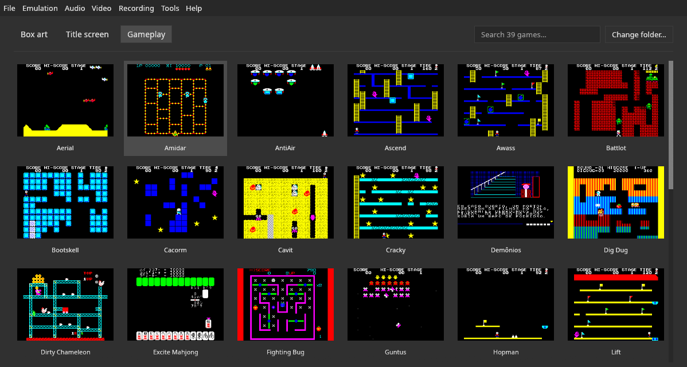
*Biblioteca: pantalla de juego*

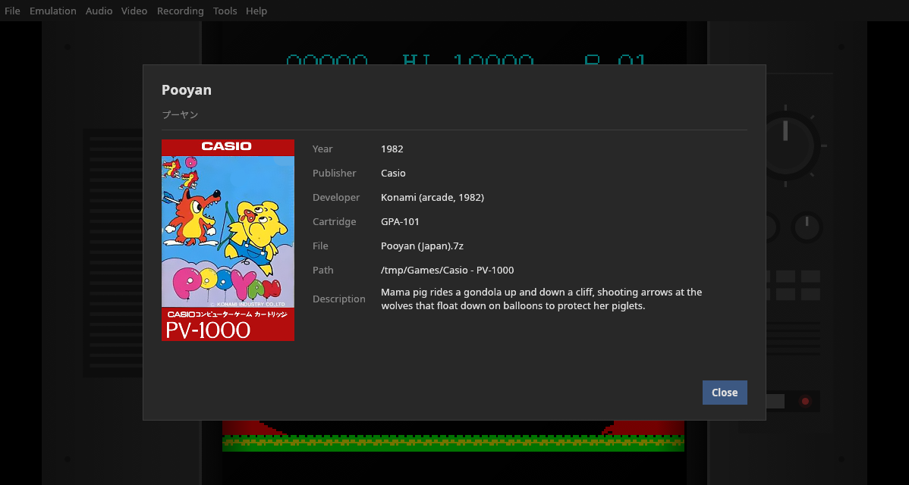
*Ficha del juego*

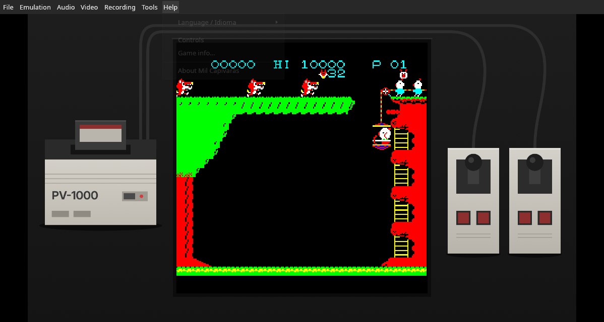
*Marco: consola y controles*

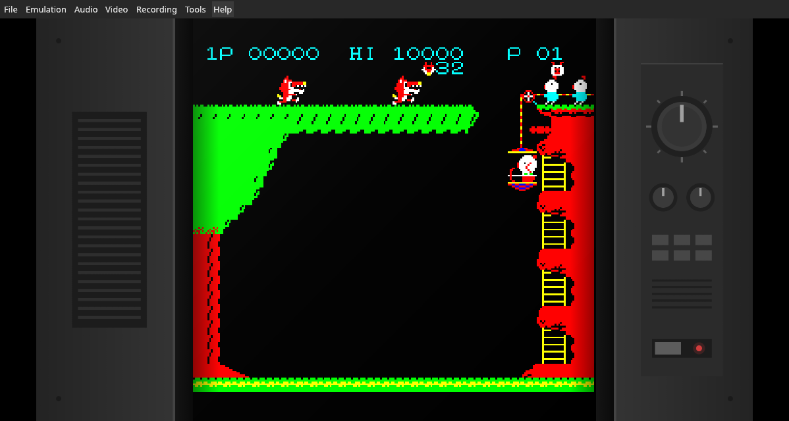
*Marco: TV*

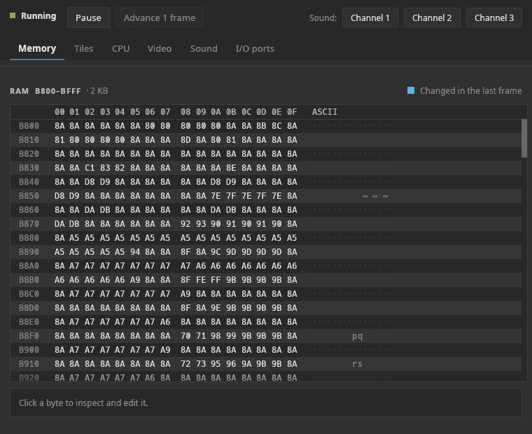
*Depurador: memoria*

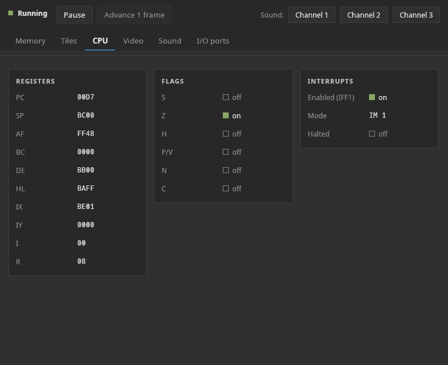
*Depurador: CPU*

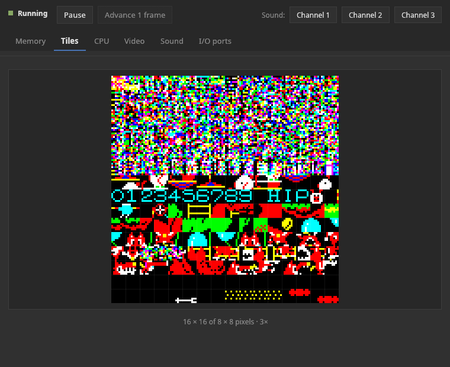
*Depurador: tiles*

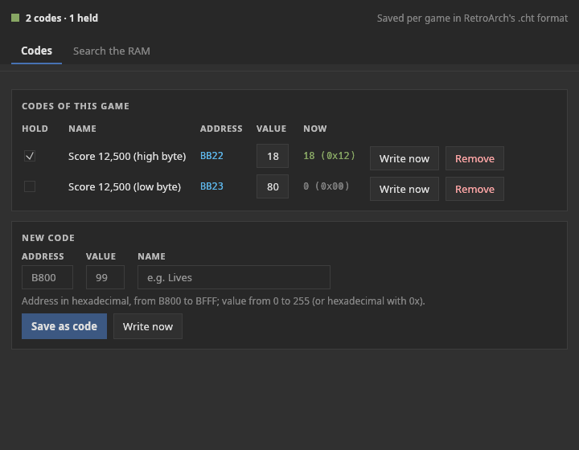
*Trucos*

### Biblioteca

Es lo que muestra la ventana cuando no hay ningún juego abierto (como en DuckStation y PCSX2):
- cuadrícula con la **carátula** (vertical, 7 × 2) o con la **pantalla de título / pantalla de juego**
  (horizontal 4:3, 6 × 3);
- búsqueda, cambio de carpeta, y clic para abrir;
- **F5** (o **Archivo › Actualizar lista de juegos**) vuelve a leer la carpeta de ROMs, para
  juegos añadidos, borrados o renombrados con el emulador abierto;
- **primer arranque:** con la carpeta sin juegos, la biblioteca muestra una pantalla de
  bienvenida, con el botón **Elegir la carpeta de ROMs…** (o la A del mando) y enlaces a
  **juegos gratuitos y legales** (los homebrews de Inufuto, PVong y
  la ROM de prueba de los mandos);
- clic derecho: **Abrir** y **Ficha del juego…**;
- los juegos se reconocen **por el contenido** (CRC32), así que el nombre del archivo no
  importa (`digdug.bin`, `juego.7z`…);
- las carátulas vienen de **libretro-thumbnails**, descargadas en segundo plano y guardadas en
  caché. Los homebrews no están allí: las suyas vienen de
  [emulation-thumbnails](https://github.com/PSGM-Romhacking/emulation-thumbnails) del
  proyecto, con el mismo formato. Las dos se buscan por el nombre No-Intro de la ROM, como en
  RetroArch.

Formatos aceptados: `.pv1`, `.bin`, `.rom`, y esos mismos dentro de `.zip` o `.7z`. `.pv1`
es una extensión propia del PV-1000, para no confundirlo con ROMs de otros sistemas; MAME
y los demás emuladores solo aceptan `.bin`, así que es mejor distribuir las ROMs con `.bin`.

### Ficha del juego

Título original en japonés, año, editora, desarrolladora, código del cartucho, nombre y
ruta completa del archivo, y descripción, en inglés, portugués y español. Todos los juegos
de la base tienen ficha; las descripciones de los homebrews de Inufuto vienen de las páginas de
Inufuto (Aerial y Guntus no tienen texto allí), las de los otros homebrews, de sus propios
autores y proyectos, y Dirty Chameleon todavía no tiene descripción. Proviene de la base de juegos del proyecto
(`assets/games/`), que partió de la lista de software de MAME (CC0). Formato y reglas en
[`docs/sheets.es.md`](docs/sheets.es.md). Los títulos japoneses usan una fuente integrada (46 KB,
recorte de Noto Sans CJK), así que aparecen en cualquier distro.

### Jugar

| Función | Detalle |
|---|---|
| **Save states** | 9 slots por juego, con miniatura del momento guardado y fecha/hora; el archivo guarda la huella digital de la ROM y rechaza el estado de otro juego |
| **Rebobinar** | un estado cada 2 cuadros, hasta ~30 s (~30 MB); mantener Backspace o L2 |
| **Avance rápido** | mantener (Espacio / R2) o activar y desactivar; 2x, 3x, 4x u 8x |
| **Pausa** | P por defecto (el Guide del mando abre el menú rápido, que también pausa); se pausa solo al perder el foco (opcional) y con un menú o diálogo abierto |
| **2 jugadores** | el 1.er mando es el J1, el 2.º es el J2; el teclado tiene los dos (J2 en WASD) |
| **Controles reasignables** | cada acción tiene una tecla y una entrada por mando, guardada por el nombre del driver; cualquier mando que reconozca el sistema (`/dev/input/jsX` en Linux, evdev en FreeBSD, XInput vía `gilrs` en Windows) |

### Vídeo

| Función | Detalle |
|---|---|
| Ventana 1x–6x | N píxeles de pantalla por píxel del juego, exactos incluso en Wayland |
| Escala entera | solo múltiplos enteros (píxeles uniformes) u ocupando la ventana |
| Filtros | Ninguno, Scanlines, CRT |
| **Marcos** | rellenan los laterales en pantalla completa: **TV** (el juego ocupa toda la altura, el televisor aparece a los lados), **Consola** (el PV-1000 y los mandos dibujados) y **Carátula del juego** (desenfocada y oscurecida) |
| Pantalla completa | F11; la barra de menús desaparece y vuelve cuando el ratón toca el borde superior |
| FPS y velocidad | indicador opcional |

### Sonido

Empieza **silenciado** (la onda cuadrada es fuerte) y con el volumen al 30%. El **sonido suave** (pasa-bajos
de ~4 kHz y bloqueo de DC) viene activado y quita la aspereza de la onda cuadrada.

### Grabación

| Función | Detalle |
|---|---|
| Captura de pantalla | F12: PNG 4x en `~/Imágenes/Mil Capivaras/` |
| GIF | F9: paleta exacta de los 8 colores, 2x, ~30 fps |
| MP4 con sonido | F10: H.264 + AAC vía `ffmpeg`, 4x, a la tasa exacta de 59,538 fps (59,299 en el modelo de hardware) |

Las grabaciones van a `~/Vídeos/Mil Capivaras/` (son las carpetas XDG de Imágenes y Vídeos;
el nombre sigue el idioma del sistema, por ejemplo `~/Pictures/` y `~/Videos/` en un sistema en inglés). La codificación se ejecuta en un hilo aparte, y
cerrar el programa en mitad de una grabación termina el archivo antes de salir.

### Herramientas

- **Depurador** (ventana aparte):
  - RAM en vivo como editor hexadecimal: encabezado de columnas, bytes en dos grupos de 8,
    columna ASCII, los bytes que cambiaron en el último cuadro resaltados y un inspector
    del byte elegido (hex, decimal, con signo, binario) con edición;
  - los 256 tiles tal como los ve el chip, con cuadrícula y el número del tile bajo el
    ratón;
  - tarjetas con los registros y flags del Z80, las interrupciones, el estado del video
    (color del borde, banco de patrones, direcciones del mapa y del PCG), los 3 canales de
    sonido con la frecuencia en Hz y los puertos F8–FF;
  - estado (en marcha / en pausa), pausar, avanzar 1 cuadro y activar o desactivar cada canal.
- **Trucos**, en dos pestañas:
  - **Códigos:** los códigos del juego (valor editable, valor actual en vivo, **Escribir
    ahora**, **Quitar** y **Fijar**, que mantiene el valor en cada cuadro) y, debajo, el
    formulario de **nuevo código** (dirección, valor, nombre; "Escribir ahora" cambia una vez y el
    juego sigue desde ahí, "Guardar como código" lo guarda en la lista);
  - **Buscar en la RAM:** 1. empezar la búsqueda; 2. jugar hasta que el valor cambie e indicar qué
    pasó (Aumentó, Disminuyó, Cambió, No cambió, Es igual a), repitiendo hasta que queden
    pocas direcciones; 3. **Usar** lleva la dirección elegida a la pestaña Códigos.
  - Valores en decimal (0 a 255) o hexadecimal con `0x`; se muestran en los dos formatos.
  - **Las puntuaciones suelen estar en BCD** (dos dígitos decimales por byte), así que se busca
    con Aumentó / No cambió, no con el número de la pantalla. Además, el marcador en pantalla solo cambia cuando
    el juego lo redibuja. Ejemplo probado, **Pooyan:** puntuación en 0xBB22 (bajo) y 0xBB23
    (alto), en decenas de puntos; escribir 0x50 y 0x12 da 12.500 puntos.
  - Se guardan por juego en el formato `.cht` de RetroArch, que funciona también en RetroArch con el
    core libretro.

### Mando y modo sofá

Para jugar desde el sofá, en la TV o en una portátil, sin teclado ni ratón:

- **Menú rápido, el "Esc" del mando:** se abre y se cierra en cualquier lugar (biblioteca
  o juego, con o sin modo sofá) con:
  - el botón **Home/Guide** (el botón central que tienen muchos mandos), por defecto. Es la
    acción **Menú rápido** en **Emulación › Controles y atajos…**, y puede ir a
    cualquier otro botón o tecla;
  - **Select + Start mantenidos juntos medio segundo**, para mandos sin Home. Mientras los
    mantienes, aparece "Sigue manteniendo Select + Start…". Se puede desactivar en
    **Emulación › Select + Start (mantener) abre el menú**;
  - **Esc**, en el modo sofá. Pausa el juego y ofrece: Continuar, Guardar estado, Cargar estado, Reiniciar,
  Volver a la biblioteca, **Modo sofá** (así se activa desde el mando) y Salir. En la
  biblioteca las entradas son Continuar, Imagen de la biblioteca, Modo sofá y Salir; en el
  modo sofá, Modo sofá pasa a ser **Salir del modo sofá**. La cruceta elige, el botón de
  abajo (A en Xbox) confirma y el de la derecha (B) vuelve.
- **Biblioteca con el mando:** la cruceta (o el stick izquierdo, o las flechas) mueve una
  selección entre las carátulas, con borde de foco; mantener repite. El botón de abajo abre
  el juego; **Select pulsado solo** cambia la imagen (carátula, título, juego). Start no se
  usa para navegar: queda libre para la combinación y para el juego.
- **Modo sofá** (**Vídeo › Modo sofá**, o `--couch` en la línea de comandos): pantalla
  completa, sin barra de menús, carátulas más grandes y una línea de ayuda con los botones
  (durante el juego, solo unos segundos, para no tapar la imagen). Queda guardado en las
  preferencias hasta desactivarlo en el menú rápido.
- **El botón no "se filtra" al juego:** mientras Select + Start están mantenidos juntos, el
  juego no los recibe; y después de abrir un juego o cerrar el menú con el mando, la
  entrada del juego se ignora hasta que se sueltan todos los botones.

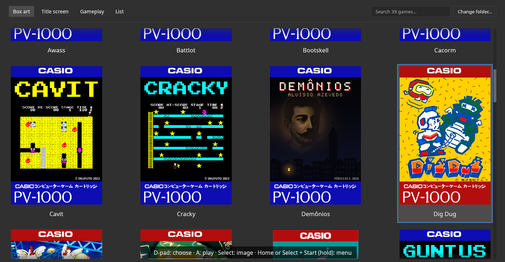
*Biblioteca en modo sofá*

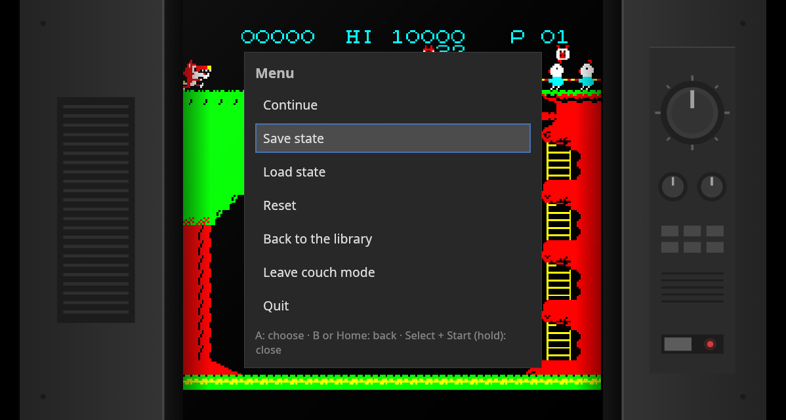
*Menú rápido sobre el juego*

### Interfaz

- Barra de menús al estilo de escritorio (Archivo, Emulación, Audio, Vídeo, Grabación,
  Herramientas, Ayuda), colores gris oscuro de Blender, sin esquinas redondeadas.
- **Idiomas:** inglés (predeterminado), portugués y español, intercambiables en vivo.
- Las preferencias, la carpeta de ROMs, los juegos recientes, las teclas y los mandos quedan guardados.
- Ícono propio, acceso directo en el menú de aplicaciones y lanzador en la carpeta (`make install`).

---

## 5. Instalación y uso

### Descargar

Los binarios están en los [releases](https://github.com/PSGM-Romhacking/mil_capivaras/releases):

| Archivo | Sistema |
|---|---|
| `mil-capivaras-0.9.0-linux-x86_64.AppImage` | Linux x86-64 (glibc 2.27 o más reciente: Debian, Fedora, Arch, openSUSE y derivadas) |
| `mil-capivaras-0.9.0-windows-x86_64.exe` | Windows 10 y 11, 64 bits |
| `mil-capivaras-0.9.0-freebsd-x86_64.tar.gz` | FreeBSD 14 o más nuevo, amd64 (necesita algunos paquetes, ver abajo) |
| `mil-capivaras-0.9.0-linux-x86_64.AppImage.zsync` | el mapa de actualización del AppImage (lo usan Gear Lever y AppImageUpdate; no hace falta descargarlo) |
| `mil_capivaras_libretro-0.9.0-linux-x86_64.zip` / `-windows-x86_64.zip` / `-freebsd-x86_64.zip` | el core libretro (`.so` / `.dll`) y su `.info`, para la carpeta de cores de RetroArch |
| `SHA256SUMS` | las sumas SHA-256 de todos los archivos, para verificar la descarga (`sha256sum -c SHA256SUMS`) |

En Linux: `chmod +x mil-capivaras-0.9.0-linux-x86_64.AppImage` y ejecutarlo. No hace falta
instalar nada. Los releases los arma GitHub Actions en cada tag de versión
(`.github/workflows/release.yml`), y las notas de cada versión salen de
[`CHANGELOG.md`](CHANGELOG.md).

En FreeBSD el programa usa las bibliotecas del sistema, que se instalan una vez con:

```sh
pkg install alsa-lib alsa-plugins libxkbcommon gtk3 zenity
```

`zenity` (o `xdg-desktop-portal-gtk`) muestra los selectores de carpeta y de archivo; sin
él, "Elegir la carpeta de ROMs…" no abre nada. Después basta descomprimir el `.tar.gz` y
ejecutar `./mil-capivaras` dentro de la carpeta `mil-capivaras-0.9.0-freebsd-x86_64/` que crea. Se compila en una VM FreeBSD 14.3 con el mismo workflow de
release y se probó en FreeBSD 15.1 (XFCE): imagen, biblioteca, ventanas y selectores de
carpeta y un mando (Flydigi Vader 3). El sonido en FreeBSD todavía no se probó.

**Los mandos en FreeBSD** se leen de `/dev/input/event*` (evdev), la interfaz de los
drivers `hgame` (gamepads HID genéricos) y `xb360gp` (tipo Xbox 360). Por defecto solo root
puede leer esos dispositivos, así que da acceso a tu usuario una vez: añádelo al grupo
`operator` (`pw groupmod operator -m $USER`) y, como root, agrega esta regla:

```sh
printf "[localrules=10]\nadd path 'input/event*' mode 0660 group operator\n" >> /etc/devfs.rules
sysrc devfs_system_ruleset=localrules
service devfs restart
```

Sin ella, la pantalla de controles avisa "sin permiso para leer /dev/input". Los mandos
salen con la misma numeración de botones y el mismo mapeo predeterminado que en Linux, así
que los mapeos sirven en los dos.

**Entre los BSD, solo FreeBSD es compatible.** OpenBSD, NetBSD y DragonFly BSD son
sistemas distintos: el programa de FreeBSD no funciona en ellos y no se compila para ellos
(OpenBSD además necesitaría otra salida de sonido, porque no tiene ALSA). Los escritorios
basados en FreeBSD, como GhostBSD y NomadBSD, deberían funcionar, pero no se probaron.
FreeBSD es, con diferencia, el BSD más usado: cerca del 95% de los sitios web que usan un
BSD ([W3Techs](https://w3techs.com/technologies/details/os-bsd/all/all), 2026).

### Compilar

```bash
make                    # cargo build --release + copia a ./mil-capivaras-0.9.0-linux-x86_64
make install            # acceso directo "Mil Capivaras" en el menú de aplicaciones + íconos
make install-libretro   # core libretro en la carpeta de cores de RetroArch
packaging/build_linux.sh      # dist/…AppImage y el core .so (necesita cargo-zigbuild y zig)
packaging/build_windows.sh    # dist/…exe y .dll, compilados en Linux con MinGW
```

Requisitos: Rust (cargo) y la biblioteca de audio ALSA (`alsa-lib-devel` en Fedora y
openSUSE, `libasound2-dev` en Debian y Ubuntu, `alsa-lib` en Arch).

Opcionales en tiempo de ejecución: `ffmpeg` (grabar MP4), `curl` (descargar carátulas) y
`xdg-open` (abrir carpetas). Sin ellos, solo esas funciones quedan no disponibles.

### Qué hace falta para ejecutarlo

Solo el archivo **`mil-capivaras-0.9.0-linux-x86_64`** (nombre, versión, sistema y arquitectura). Todo va integrado en él: ícono, traducciones, base de juegos, fuente japonesa, tema y marcos. Al ejecutarse, crea:

| Carpeta | Contenido |
|---|---|
| `~/.config/mil_capivaras/config.json` | preferencias, carpeta de ROMs, recientes, teclas y mandos |
| `~/.config/mil_capivaras/states/` | save states y miniaturas |
| `~/.config/mil_capivaras/cheats/` | trucos (`.cht`) |
| `~/.config/mil_capivaras/covers/` | tus propias carátulas (opcional, ver abajo) |
| `~/.config/mil_capivaras/languages/` | tus propias traducciones (opcional, ver abajo) |
| `~/.config/mil_capivaras/cache/covers/` | carátulas descargadas (se pueden borrar sin problema) |
| `~/Imágenes/Mil Capivaras/`, `~/Vídeos/Mil Capivaras/` | capturas y grabaciones |

Todo, salvo capturas y grabaciones, está en **una sola carpeta**: para una copia de
seguridad o una sincronización (Syncthing, Nextcloud…) basta `~/.config/mil_capivaras/`.
En Windows es `%APPDATA%\mil_capivaras\`, con la misma estructura. Las versiones
de desarrollo anteriores a la 0.9 separaban los datos al estilo XDG (`~/.local/share/mil_capivaras/` y
`~/.cache/mil_capivaras/`); en la primera ejecución, el emulador los mueve solo a la
carpeta nueva, sin sobrescribir nada.

### Modo portátil

Crea un archivo vacío llamado **`portable.txt`** junto al AppImage o al `.exe`, y todo
(preferencias, partidas guardadas, trucos, carátulas, idiomas, capturas y grabaciones) pasa
a una carpeta **`mil_capivaras_data/`** a su lado, en lugar de la carpeta del usuario:

```
Pendrive/MilCapivaras/
├── mil-capivaras-0.9.0-linux-x86_64.AppImage
├── portable.txt
├── roms/
└── mil_capivaras_data/
```

Las rutas dentro de la carpeta del programa (la carpeta de ROMs, los juegos recientes, las
carpetas cambiadas) se guardan relativas a ella, así que todo sigue funcionando cuando el
pendrive se monta en otro lugar o en otro PC. Sirve para un pendrive, una carpeta
sincronizada o el ordenador de otra persona (no se escribe nada en el perfil del usuario).
Si la carpeta no admite escritura (un CD, un recurso compartido de solo lectura), el
emulador lo avisa al iniciar y usa la carpeta normal. Una copia portátil empieza de cero:
no trae los datos de la instalación normal.

### Carpetas, carátulas propias e idiomas nuevos

**Emulación › Carpetas…** muestra todas las carpetas (ROMs, save states, trucos, carátulas
propias, idiomas, capturas, grabaciones), cada una con **Abrir** (en el gestor de
archivos), **Cambiar…** y **Predeterminada**. Con "Al cambiar una carpeta, llevar sus archivos" activado (lo predeterminado), cambiar una carpeta se lleva sus archivos; un
archivo con el mismo nombre que ya esté en la carpeta nueva nunca se sobrescribe. Si una
carpeta cambiada no existe al iniciar (un disco desconectado), aparece un aviso y se usa la
predeterminada en esa sesión, sin olvidar tu elección.

**Carátulas propias.** Pon PNG en la carpeta de carátulas con la estructura de
[libretro-thumbnails](https://github.com/libretro-thumbnails/libretro-thumbnails):
`Named_Boxarts/` (carátula), `Named_Titles/` (pantalla de título) y `Named_Snaps/` (juego).
El nombre del archivo es el nombre No-Intro de la ROM (`Pooyan (Japan).png`) o el que
aparece bajo la tarjeta en la biblioteca (`Cacorm.png`). Tus imágenes tienen prioridad
sobre las descargadas, así que también sirven para cambiar una carátula que no te gusta.
Un clon de un repositorio con el formato de libretro-thumbnails funciona tal cual.

**Idiomas nuevos.** **Ayuda › Language / Idioma › Exportar plantilla de traducción…** guarda un JSON
con todos los textos de la interfaz, cada uno apuntando a sí mismo (el texto en inglés),
más `"@name"`. Traduce los valores, escribe el nombre del idioma en su propia lengua en
`"@name"` ("Français"), nombra el archivo con el código del idioma (`fr.json`,
`pt-PT.json`), ponlo en la carpeta de idiomas y reinicia: el idioma aparece en
**Ayuda › Language / Idioma**. Un valor vacío significa "todavía sin traducir" (se muestra el texto en
inglés). Un archivo con el nombre de un idioma integrado (`pt.json`, `es.json`) corrige
solo los textos que contiene.

La guía completa, con las reglas del formato, una lista de pantallas para probar y **cómo
enviar una traducción para que entre en la próxima versión**, está en
[`docs/translating.es.md`](docs/translating.es.md).

### Línea de comandos

```bash
./mil-capivaras-0.9.0-linux-x86_64                              # abre la biblioteca
./mil-capivaras-0.9.0-linux-x86_64 "Dig Dug (Japan).7z"         # abre un juego (.pv1, .bin, .rom, .zip, .7z)
./mil-capivaras-0.9.0-linux-x86_64 "/ruta/Casio - PV-1000/"     # abre la biblioteca en esa carpeta
./mil-capivaras-0.9.0-linux-x86_64 juego.bin --scale 4          # ventana a 4x
./mil-capivaras-0.9.0-linux-x86_64 --couch                      # modo sofá (queda guardado)
./mil-capivaras-0.9.0-linux-x86_64 --identify CARPETA           # CRC32 y juego de MAME de cada ROM
./mil-capivaras-0.9.0-linux-x86_64 --info JUEGO                 # ficha del juego en la terminal
./mil-capivaras-0.9.0-linux-x86_64 --controls                   # mandos detectados y botones pulsados
./mil-capivaras-0.9.0-linux-x86_64 --memory-map                 # mapa de memoria (formato RetroAchievements)
./mil-capivaras-0.9.0-linux-x86_64 JUEGO --bench 3000           # velocidad, sin ventana
./mil-capivaras-0.9.0-linux-x86_64 JUEGO --shot 500 q.ppm --press-start --dump-ram ram.bin  # validación
./mil-capivaras-0.9.0-linux-x86_64 JUEGO --shot 500 q.ppm --hardware                         # lo mismo, en el modelo de hardware real
```

### Controles predeterminados

| Acción | Teclado | Mando |
|---|---|---|
| Dirección | flechas | d-pad y analógico izquierdo |
| Fire 1 / Fire 2 | Z / X | botón de abajo / de la derecha (A / B en Xbox) |
| Select / Start | Tab / Enter | Back / Start |
| J2 (dirección, Fire 1, Fire 2, Select, Start) | WASD, F, G, Q, E | 2.º mando |
| Biblioteca: mover / abrir el juego | flechas / Enter | d-pad o analógico izquierdo / botón de abajo |
| Imagen de la biblioteca (carátula, título, juego) | las pestañas de arriba | Select |
| Pausa / reiniciar | P / F1 | — |
| Menú rápido (abrir y cerrar) | Esc (en modo sofá) | Home/Guide; Select + Start mantenidos medio segundo (opción) |
| Guardar / cargar estado; slot −/+ | F2 / F4; F6 / F7 | — |
| Avance rápido / rebobinar (mantener) | Espacio / Backspace | R2 / L2 |
| Sonido; volumen +/− | M; = / − | — |
| Pantalla completa (Esc sale); captura; GIF; MP4 | F11; F12; F9; F10 | — |
| Abrir / cerrar juego / salir | Ctrl+O / Ctrl+W / Ctrl+Q | — |
| Actualizar lista de juegos (vuelve a leer la carpeta de ROMs) | F5 | — |

Todo es reasignable en **Emulación › Controles y atajos…**. Sin configuración,
los botones del mando vienen del código que informa el driver (posicional, como en
RetroArch), no de números fijos.

---

## 6. Arquitectura del código

Un *workspace* de Cargo con el núcleo de la consola separado de la interfaz. Detalles y decisiones
en [`docs/architecture.es.md`](docs/architecture.es.md).

```
crates/api/              contrato núcleo ↔ interfaz (sin dependencias)
crates/core/             la consola; solo depende de emu-api, iz80 y serde/serde_json
crates/frontend/         la interfaz reutilizable; no conoce ninguna consola
crates/app/              el ejecutable: núcleo + interfaz + identidad de la app
crates/libretro/         el núcleo detrás de la API C de libretro (mil_capivaras_libretro.so)
vendor/iz80/             la CPU Z80, con ciclos y registro R corregidos
assets/                  datos integrados: íconos, marcos, fuentes, traducciones, base de juegos
docs/                    arquitectura, base de juegos, core libretro, precisión, traducción
```

```
                 ┌──────────────────────┐
                 │      crates/app      │  marca, traducciones de la app, línea de comandos
                 └───────┬───────┬──────┘
                         │       │
        ┌────────────────▼─┐   ┌─▼─────────────────────┐
        │  emu-frontend    │   │  pv1000-core          │
        │  (egui, audio,   │   │  machine.rs (consola) │
        │  mandos, …)      │   │  core.rs (adaptador)  │
        └────────┬─────────┘   └──┬──────────┬─────────┘
                 │                │          │
                 └──────┬─────────┘          │
                   ┌────▼────┐          ┌────▼────┐
                   │ emu-api │          │  iz80   │ (vendor/)
                   └─────────┘          └─────────┘
        libretro ──► pv1000-core + emu-api (sin egui)
```

### `emu-api`: el contrato

- El **trait `Core`**: `load`, `reset`, `run_frame(&[u16])`, `video()`,
  `take_audio()`, `save_state()`, `load_state()`, `system_ram()` / `system_ram_mut()`,
  `debug_views()`, `sound_channels()`, `options()` / `set_option()` y `fps()` (la tasa de
  cuadros actual, que en el PV-1000 depende del modelo).
- El **`SystemInfo`**: nombre, extensiones, botones, resolución, proporción, FPS como fracción
  exacta, dirección de la RAM, identificación por hash y fichas.
- Sigue las **convenciones de libretro**: mando como bitmask RetroPad en el mismo orden de
  bits, imagen XRGB8888, audio f32 estéreo intercalado, estado en bytes opacos. Por eso
  el core libretro es solo una traducción fina, y cambiar de interfaz no toca el núcleo.

### `pv1000-core`: la consola

| Archivo | Contenido |
|---|---|
| `machine.rs` | el PV-1000: estado, bucle de la CPU, interrupciones y los dos bucles de cuadro (MiSTer y hardware); portado de `CasioPV1000.v` |
| `machine/bus.rs` | memoria y puertos tal como los ve la CPU, la matriz del joystick y los registros de video de los puertos FE y FF |
| `machine/video.rs` | el dibujo: la línea actual se dibuja mientras corre la CPU |
| `machine/timing.rs` | base de tiempo y constantes de temporización de los dos modelos |
| `machine/sound.rs` | el generador de sonido: 3 ondas cuadradas, puerto FB, volúmenes y filtros pasa-altos |
| `machine/state.rs` | el save state y su formato de archivo |
| `machine/debug.rs` | depuración: registro de interrupciones, rastreo de instrucciones, registros, memoria y tiles |
| `machine/tests.rs` | las pruebas de la consola, incluidas las de las mediciones de Par |
| `core.rs` | adaptador para `Core`: RetroPad → bits de MiSTer, mono → estéreo, vistas de depuración, `INFO` |
| `memory.rs` | mapa de memoria y lectura "plana" en el formato de RetroAchievements |
| `games.rs` | la base de juegos: identificación por CRC32, año, editora, cartucho, jugadores |
| `assets/games/` (en la raíz) | la base (`games.json`) y los textos de los juegos (un JSON por idioma) |

No abre ventanas, no reproduce sonido y no lee archivos: es lo que exige un core libretro.

### `emu-frontend`: la interfaz

| Archivo | Contenido |
|---|---|
| `app.rs` | la ventana: estado de la app, creación, abrir y cerrar juegos, preferencias, el ciclo de cada cuadro de la interfaz |
| `app/emulation.rs` | el bucle de emulación: ritmo, entrada, rebobinado, avance rápido, sonido |
| `app/input.rs` | teclado y mando: atajos y asignaciones |
| `app/nav.rs` | navegación con el mando, menú rápido y modo sofá |
| `app/menus.rs`, `app/screen.rs` | la barra de menús; la pantalla del juego con marcos y filtros |
| `app/library.rs` | la biblioteca, la identificación de los juegos y las fichas |
| `app/state.rs`, `app/recording.rs` | save states; capturas y grabaciones |
| `app/controls.rs`, `app/dialogs.rs` | el diálogo de controles; los demás diálogos |
| `app/folders.rs` | la ventana **Emulación › Carpetas…** |
| `app/docshots.rs` | el recorrido de capturas de la documentación (`EMU_DOCSHOTS`) |
| `debugger.rs`, `cheats.rs` | las herramientas, en ventanas aparte |
| `gamepad.rs`, `keys.rs` | mandos en un hilo (`/dev/input/jsX` en Linux, `gilrs` en Windows), y teclas |
| `gamepad/evdev.rs` | mandos en FreeBSD (evdev) |
| `audio.rs`, `recorder.rs` | salida de sonido (cpal) y grabación GIF/MP4 |
| `covers.rs`, `sheets.rs`, `rom.rs` | carátulas, fichas, lectura de `.zip`/`.7z` |
| `config.rs`, `i18n.rs`, `brand.rs` | preferencias, idiomas, identidad de la app |
| `platform.rs` | lo que cambia entre sistemas: carpetas base, hora local, abrir una carpeta |
| `theme.rs`, `widgets.rs`, `menu.rs` | tema y componentes de la interfaz |
| `achievements.rs` | ganchos para RetroAchievements (aún sin efecto) |

La interfaz no conoce el PV-1000: otro emulador sería otra app con el mismo
`emu-frontend` y un núcleo que implemente `Core`.

### Pruebas

`cargo test --release --workspace` cubre, por crate:
- **API:** CRC32 estándar; bits del RetroPad en el orden de libretro.
- **Núcleo:** la consola (aviso de cuadro, `HALT`, modos de interrupción, bus abierto, tono
  y pasa-altos, matriz en OR y su retardo, robo de bus, mediciones de Par); save state
  determinista; el adaptador igual que la consola directa; asignación RetroPad; FPS exacto;
  imagen TV; la base de juegos (lista de MAME, consistencia, textos, homebrews sin
  relleno); RAM plana para RetroAchievements.
- **Interfaz:** catálogos de traducción completos e idiomas del usuario; formato `.cht` de
  ida y vuelta; fichas en los 3 idiomas; glifos japoneses; grabación MP4 con sonido;
  asignación de mandos, también por evdev; teclas; mover carpetas y modo portátil; la
  cabecera del save state.
- **App:** catálogo de la app completo; textos de los juegos válidos; marcos transparentes
  donde entra el juego.
- **Core libretro:** la API en C igual que el núcleo directo (cuadros, tasa de audio, save
  state, RAM).

La copia de `iz80` pasa ZEXALL.

---

## 7. Cómo funciona la emulación

### Base de tiempo

Todo se cuenta en **unidades de 1/17,897727 MHz** (un tick de `clk_snd`):
- **ciclo de CPU = 5 unidades**;
- **píxel = 3 unidades**;
- **línea = 1.143 unidades**.

Con enteros, CPU, video y sonido avanzan juntos sin error de redondeo.

### Un cuadro

Para cada una de las 263 líneas:
1. marca el inicio de la línea y pone a cero el contador de píxeles dibujados;
2. en la línea Y=195, activa el bit "cuadro nuevo" del puerto FC;
3. en las líneas de interrupción, ejecuta la CPU hasta 2 ciclos después del inicio de la línea, activa
   la interrupción, ejecuta hasta hc 190 (+2 ciclos) y la desactiva;
4. ejecuta la CPU hasta el final de la línea, **instrucción por instrucción**, con los ciclos exactos de
   cada una;
5. dibuja el resto de la línea.

### El cuadro en el modelo de hardware real

El modelo de hardware tiene un bucle propio (`run_frame_hw`), con las medidas de la consola
([Un cuadro en la consola](#un-cuadro-en-la-consola)).

**Base de tiempo.** La misma unidad (1/17,897727 MHz, el cristal): el ciclo de CPU sigue
valiendo 5 unidades, pero el píxel pasa a valer **4** (cristal ÷ 4). Una línea tiene 288
píxeles = 1152 unidades = 230,4 ciclos; el cuadro, 262 líneas = 301.824 unidades =
59,299 Hz.

**Dónde empieza el cuadro.** Las líneas se numeran como en NESdev (0 = primera línea de
imagen). El bucle empieza en la línea **246**, de modo que las 224 primeras líneas del
cuadro (16 de borde, las 192 de imagen y 16 de borde) caen en las mismas líneas de la imagen
de salida que en el modelo MiSTer. Las otras 38 líneas (el resto del borde, el apagado y el
sincronismo) se emulan pero no se muestran.

**Para cada línea:**
1. si es una línea de imagen (0–191), marca la ventana del **BUSREQ**: del píxel 20 al 267;
2. si es una línea de interrupción (195, 199 … 255), corre la CPU hasta el **píxel 276** y
   guarda el pedido: bit 1 (matriz) en las 16 líneas, bit 0 (prerrenderizado) también en la
   255, solo si están habilitados en el puerto FC;
3. corre la CPU hasta el final de la línea y dibuja lo que falte.

**El robo de bus** está dentro del bucle de la CPU (`run_until`):
- antes de cada instrucción: si la CPU está dentro de la ventana del BUSREQ y la imagen
  está encendida (bit 3 del puerto FF en 0), salta al final de la ventana;
- una instrucción que empieza antes de la ventana y termina más de 4 ciclos después de su
  inicio se corta ahí y termina después de la ventana (el Z80 cede el bus al inicio de un
  ciclo de máquina). Una que termina hasta 4 ciclos después pasa entera. Eso deja de 32 a 36
  ciclos libres por línea de imagen, cerca de los 32 a 37 medidos;
- con la imagen apagada no hay ventana: la CPU corre el cuadro entero.

**La interrupción** queda activa **mientras haya un pedido guardado**, hasta que el
programa lo reconozca: leer el puerto FD limpia el bit 1, escribirlo limpia el bit 0, y
deshabilitarlo en FC también lo limpia.

**El dibujo.** La columna *c* de la imagen es el píxel 52 + *c* de la línea, y muestra las
columnas de tiles 2 a 29 enteras (en el modelo MiSTer, la imagen empieza 1 píxel después y
la última columna es negra). Las escrituras en medio de la línea siguen valiendo: en las
líneas de borde, donde la CPU corre libre, un cambio de color del borde aparece desde el
píxel en que ocurrió (es lo que dibuja la barra de `irqtiming`).

**El retardo de la matriz.** Cada una de las 4 entradas del puerto FD tiene un condensador
en la consola. El emulador guarda, para cada entrada, cuándo dejó de ser activada (una fila
deseleccionada o un botón soltado) y la sigue leyendo como 1 durante **136 ciclos** (el
medio del rango medido, 126–147). La subida, de menos de ~15 ciclos, se trata como
instantánea. El estado entra en el save state (versión 3).

**Puertos y video:** el puerto FE encuentra el mapa y el PCG, los 3 bits altos
de FF eligen el banco y el bit 3 apaga la imagen; los puertos sin dueño leen `0xFF`. La RAM está
reflejada en 0x8000–0xBFFF, como en el aparato (en el modelo MiSTer, la memoria es plana,
como en el core).

### La CPU

El Z80 viene del crate **[`iz80`](https://github.com/ivanizag/iz80)**, de Iván Izaguirre, en una copia en `vendor/iz80` con cinco correcciones (las cuatro primeras medidas
contra TV80):
- **ciclos:** prefijos DD/FD (+4 cada uno; operandos `(IX+d)` +8), `JR cc` no tomado (7) y
  `JP cc` (10);
- **registro R:** suma 1 en cada búsqueda de opcode, manteniendo el bit 7;
- **`LD A,R` y `LD A,I`:** pasan a ajustar los flags S y Z;
- el **HALT** avanza en pasos de 4 ciclos, sumando 1 al R en cada uno, y solo acepta la
  interrupción al final de un paso. El `iz80` original nunca salía del HALT, ni siquiera con la
  interrupción pendiente; en la copia corregida, la interrupción lo termina (los juegos comerciales
  y los de Inufuto no usan HALT; Demônios y la PV-1000 Control Test sí, para esperar el
  cuadro);
- **IM 0 e IM 2**, que `iz80` no implementaba, con el bus supuesto en 0xFF (IM 0 =
  `RST 38h`; IM 2 lee el vector en (I × 256) + 0xFF).

**La CPU en las baterías de prueba estándar:** la copia corregida pasa las **67 pruebas de
ZEXALL** y la prueba del 8080. En `z80test` (Patrik Rak), que verifica incluso los
comportamientos no documentados, pasa 137 de 152: las 15 fallas (flags 3 y 5 de SCF/CCF, el
registro interno MEMPTR en `BIT n,(IX+d)`, las flags de las instrucciones `IN` y
`LD A,I`/`LD A,R`) son **las mismas del `iz80` original**, es decir, las correcciones del
proyecto no rompieron ninguna instrucción. Ningún juego depende de esos detalles;
corregirlas exige verificar antes qué hace el TV80, base del modelo MiSTer.

Detalles finos de la temporización:
- la interrupción se ve **2 ciclos después** de cambiar, como en TV80;
- la **primera instrucción tras el reset** es 2 ciclos más corta.

### El video, píxel a píxel

El chip lee la RAM durante cada píxel. Mil Capivaras lo reproduce **dibujando la línea por
partes**:
1. cada escritura en el mapa de tiles, en el PCG (0xB800–0xBFFF) o en el puerto FF se guarda con
   el valor antiguo y el nuevo;
2. al final de la instrucción, la escritura se fecha: en el último ciclo de máquina de la instrucción (3
   ciclos por escritura, terminando 2 antes del final), o en el **ciclo 12** en
   `LDI`/`LDD`/`LDIR`/`LDDR`, cuya escritura viene antes de los ciclos de repetición;
3. la línea se dibuja hasta ese instante con el valor antiguo, y de ahí en adelante con el
   nuevo.

El costo es bajo: de ~7.800 a ~7.400 cuadros/s.

### El sonido

Los 3 canales avanzan un paso cada 1024 ciclos del reloj de 17,9 MHz, sincronizados
con la CPU en cada escritura en los puertos F8–FB. Cada canal tiene su volumen (0,5 / 0,75 / 1,0)
y el puerto FB enciende el sonido y elige el modo XOR ([sección 2](#sonido)). Las muestras salen a la tasa de la tarjeta de sonido (48 kHz) y pasan a estéreo en el
adaptador.

### Save states

El estado es **completo y determinista**: CPU, RAM 0x8000–0xFFFF, E/S y sonido, ~33 KB.
Guardar, ejecutar y restaurar da exactamente la misma imagen y RAM; una prueba lo verifica. Por
eso funcionan el rebobinado y, en RetroArch, el run-ahead y el netplay.

---

## 8. El porqué de cada decisión

| Decisión | Por qué |
|---|---|
| **Partir del core de MiSTer, no de MAME** | un circuito en Verilog se puede simular y comparar byte a byte, y la lista de MAME marcaba 6 juegos como no soportados [M2] (marca desactualizada: en MAME 0.289 funcionan los 13). El precio: MiSTer simplifica el hardware donde MAME no lo simplifica |
| **Reescribir en Rust en lugar de simular el Verilog** | un core FPGA es hardware descrito en Verilog; simularlo (Verilator) funcionó a solo ~200% del tiempo real y exige el compilador de Verilog. Reescrito como emulador, funciona a ~12.500% y queda en un solo binario |
| **Mantener la simulación Verilator como referencia** | cada diferencia se convierte en un número (píxeles y bytes) en lugar de una impresión visual; así se encontraron y se llevaron a cero todas las divergencias |
| **Usar el crate `iz80` y corregirlo** | escribir un Z80 desde cero es mucho trabajo y mucho riesgo; `iz80` pasa ZEXALL. Los errores de ciclos y del R se corrigieron en una copia (BSD-3) con su licencia incluida, y se documentaron para enviarlos al autor |
| **224×224 y no 256×192** | es el área que muestra el core: 223 píxeles útiles por línea y el borde arriba y abajo, como en el aparato [F1] |
| **59,538 Hz y no 60** | es la tasa de la consola; la música y la velocidad de los juegos quedan como en el original. En un monitor de 60 Hz, un cuadro se repite cada ~2 s, algo que casi nadie percibe |
| **Píxeles cuadrados (1:1) por defecto** | es como lo muestra el core de MiSTer; la proporción del aparato, 48:35 [N4], queda en la opción **Imagen: TV** |
| **Lista de MAME (CC0) para identificar, no el DAT de No-Intro** | MAME reconoce también los homebrews y es de dominio público; el DAT de No-Intro era de 2020 y no tenía una licencia clara |
| **Todo integrado en el ejecutable** | un solo archivo, que funciona en cualquier carpeta; nada que perder o que quede desfasado de versión |
| **Fichas solo integradas; traducciones de la interfaz integradas y también en una carpeta de idiomas** | las fichas entran por el proyecto, pasan por las pruebas y no quedan desactualizadas en silencio; un idioma nuevo de la interfaz se puede probar sin recompilar, y un texto que falta aparece en inglés |
| **Inglés como texto fuente** | es la lengua común para quien contribuya; portugués y español son catálogos |
| **Interfaz separada del núcleo, con las convenciones de libretro** | la misma interfaz sirve para otros emuladores, y el core libretro sale casi gratis |
| **egui** | una interfaz nativa en Rust, sin Qt ni GTK, que cabe en el binario |
| **Mandos por `/dev/input/jsX` (Linux) y evdev (FreeBSD)** | funciona con cualquier mando que reconozca el kernel, sin SDL. En Windows, `gilrs` (XInput) |
| **`curl` y `ffmpeg` externos** | están en cualquier distro y no aumentan el binario; sin ellos, solo las carátulas y el MP4 quedan no disponibles |
| **Sonido según el hardware, no según MiSTer** | la afinación de los juegos no decide la octava, pero la documentación de NESdev, hecha en el aparato, sí: MiSTer toca una octava por encima e ignora el puerto FB [N2]. Cambiar el sonido no altera la imagen ni la RAM, así que la comparación con MiSTer sigue siendo válida |
| **El sonido empieza silenciado** | la onda cuadrada llena es fuerte; mejor que el usuario lo active |
| **Escrituras fechadas dentro de la instrucción, en lugar de un Z80 ciclo a ciclo** | da el mismo resultado en los 35 juegos, con un 5% de costo; un Z80 ciclo a ciclo sería reescribir la CPU |

---

## 9. Precisión y validación

### Cómo se hace la comparación

**1. Las dos "consolas"**
- **La referencia:** el core de MiSTer es la descripción del circuito del PV-1000 (en Verilog).
  Un programa (Verilator) simula ese circuito en el PC, cable por cable, reloj por reloj. Es
  lento, pero es el propio hardware de MiSTer funcionando.
- **Mil Capivaras:** el emulador, escrito desde cero en Rust, rápido.

Si Mil Capivaras es correcto, los dos tienen que hacer **exactamente lo mismo**.

**2. El mismo juego, la misma "mano"**

Los dos ejecutan la misma ROM, sin nadie jugando. Un "jugador automático" pulsa los
botones en los mismos momentos en los dos:
- pulsa **Start** del cuadro 120 al 129 (el juego sale de la pantalla de título);
- a partir del cuadro 200, alterna disparo + derecha cada 20 cuadros.

Es como dos músicos tocando la misma partitura: si los dos son fieles, el sonido sale igual.

**3. Pausa y foto en el mismo instante**

Después de N cuadros (el PV-1000 dibuja ~60 por segundo, así que el cuadro 3000 son unos 50
segundos de juego), los dos se detienen y guardan:
- **la imagen de la pantalla:** 224 × 224 puntos;
- **la memoria RAM entera:** todo lo que el juego está "pensando" (puntos, vidas, posición
  de los enemigos…).

**4. Comparar, punto por punto**

Un script compara los archivos:
- **imagen:** cuenta cuántos puntos tienen un color distinto. 0 = pantallas idénticas;
- **RAM:** cuenta cuántos bytes tienen un valor distinto. 0 = el juego está en el mismo estado en los
  dos.

La RAM es la prueba más fuerte: dos juegos pueden mostrar la misma pantalla y aun así estar
"pensando" distinto por dentro.

**5. Repetir en varios momentos y juegos**

Esto se hizo en los cuadros 2, 50, 300, 1000 y 3000, para los 39 programas. Si una diferencia
apareciera en un momento y desapareciera después, o solo apareciera con el juego funcionando desde hace mucho
tiempo, la comparación la detectaría.

**6. Cuando sale distinto: encontrar dónde empezó**

Se prueba la mitad del camino (cuadro 1500, luego 750…) hasta encontrar el primer cuadro en
el que los dos se separan. Desde ahí, un rastreo compara los dos **instrucción por instrucción**,
hasta el punto exacto en el que la CPU de cada uno hizo cosas distintas. Así se descubrió,
por ejemplo, que la biblioteca del Z80 contaba mal los ciclos.

**Resultado:** en el cuadro 3000, los 39 programas tienen pantalla y memoria **idénticas** en los dos. Es
la prueba de que Mil Capivaras se comporta como el hardware de MiSTer.

### Metodología (detalles técnicos)

1. **Referencia:** el Verilog del core de MiSTer simulado ciclo a ciclo con Verilator
   (fuera del repositorio), con la CPU TV80, que es el T80 de MiSTer en Verilog.
2. **Misma entrada:** con `--press-start`, los dos pulsan Start en los cuadros 120–129 y
   alternan Fire 1 + derecha cada 20 cuadros a partir del 200.
3. **Misma salida:** imagen de 224×224 y RAM de 64 KB en el cuadro N.
4. **Comparación:** píxeles y bytes distintos.
5. **Bisección:** si hay diferencia, se encuentra el primer cuadro, y desde ahí el rastreo instrucción a
   instrucción (PC, ciclo y R en cada búsqueda de opcode) encuentra la primera instrucción divergente.
6. **Herramientas de diagnóstico.** En el núcleo: `Pv1000::log_interrupts` registra cada
   interrupción aceptada (línea, posición, PC) y `Pv1000::trace`, cada instrucción iniciada
   (línea, posición, PC, A, R). En la simulación del core (fuera del repositorio; el Verilog
   viene de MiSTer), las mismas medidas más la RAM en cada cuadro y un "vigía" de dirección.
   Dos cuidados aprendidos al comparar:
   - el TV80 graba el resultado en el acumulador ya durante la instrucción siguiente, así
     que el A leído al inicio de ella está atrasado; hay que comparar la secuencia de PCs,
     no el A instrucción a instrucción;
   - las instrucciones con prefijo (DD, ED, FD, CB) hacen dos búsquedas de opcode en el TV80
     y una en el emulador; la interrupción aparece como una búsqueda de más en el TV80.
7. **Misma foto.** El emulador ejecuta instrucciones enteras; el core escribe en el ciclo de
   máquina. Para comparar la RAM al final de un cuadro, la simulación termina la instrucción
   en curso antes de grabar.

### Resultado

- **39 programas** (13 comerciales y 26 homebrews), imagen en los cuadros 2, 50, 300, 1000 y
  3000: **0 píxeles distintos en todos**. RAM en el cuadro 3000: **idéntica en los 39**. En el
  cuadro 1000, idéntica en 34; en los otros 5, 1 o 2 bytes de pila difieren por un artefacto de la
  comparación, no de la emulación (ver "Restos de pila" abajo). Detalles en la
  [sección 10](#10-compatibilidad).
- El PC, el ciclo y el R coinciden **en cada instrucción** en las primeras 40.000 líneas (~152
  cuadros) de los 16 juegos rastreados.

**Qué hubo que corregir para llegar ahí:**

| Problema | Dónde | Efecto antes de la corrección |
|---|---|---|
| Ciclos erróneos en `iz80` (DD/FD, `JR cc`, `JP cc`) | CPU | Excite Mahjong un 2,5% distinto; el RNG sorteaba otras fichas |
| R nunca incrementado; `LD A,R` sin S/Z | CPU | Super Cobra, Space Panic y Excite Mahjong usan el R como aleatorio |
| Interrupción vista en el acto, no 2 ciclos después | temporización | RAM divergiendo después de ~150 cuadros |
| Primera instrucción tras el reset 2 ciclos más larga | temporización | fase errónea para siempre (los bucles `JR $` la mantienen) |
| Línea dibujada de una vez | video | hasta 80 píxeles erróneos por cuadro en pantallas que cambian durante la imagen |
| Última columna dibujada | video | 1 columna distinta |

**La propia referencia tenía defectos**, corregidos en ella antes de las comparaciones:
- TV80 se compilaba sin `TV80_REFRESH` (R siempre 0) y calculaba S y Z de `LD A,R` a
  partir del I;
- el cuadro terminaba en el VSync (línea 259), y no en la vuelta a la línea 0, lo que desfasaba
  mandos y capturas en ~3 líneas;
- la fase entre el reloj de la CPU y el del video dependía del tamaño de la ROM.

**Qué sigue siendo distinto:**
- **"Restos de pila" (no es un error de emulación):** en Dig Dug, Ruptus, Uchotos y
  Yewdow, 1 o 2 bytes difieren en algunos cuadros. La causa:
  - las **interrupciones** se aceptan en el mismo cuadro, la misma línea y la misma
    instrucción en los dos, en los 4 juegos (de 11.916 a 14.209 interrupciones por juego en
    1000–1100 cuadros);
  - la **secuencia de instrucciones** es idéntica (comparada búsqueda a búsqueda en el
    cuadro donde aparecía la primera diferencia);
  - la diferencia viene **del instante de la comparación**: la RAM se graba en el cambio de
    cuadro, y una instrucción a medias (por ejemplo, `LD (IY+0),A` empezando al final de la
    línea 262) ya escribió en el emulador, que ejecuta instrucciones enteras, pero todavía no
    en el core, que escribe en su ciclo de máquina;
  - **prueba:** grabando la RAM del core después de terminar la instrucción en curso, Dig
    Dug, Uchotos y Yewdow dan **cero diferencias en 1100 cuadros**. En Ruptus quedan 2 en
    1100 cuadros, ambas de una instrucción que empieza justo en el cambio (posición 0 o
    380), que cada lado pone en un cuadro distinto por ±1 píxel de diferencia en la medida
    del tiempo.
  - **Simon** tiene la misma sobra: 1 byte en 0xBFE6, la misma
    dirección que en Uchotos.

  Las herramientas usadas (registro de interrupciones y rastreo de instrucciones en el
  núcleo, `log_interrupts`/`trace`, y las mismas opciones en la simulación del core) se
  describen en la [sección 9](#metodología-detalles-técnicos).
- **Flags no documentados:** los bits 3 y 5 del registro F después de `BIT n,(HL)`. El
  `iz80` los toma de la dirección, TV80 los pone a cero y el T80 de MiSTer usa el registro interno
  MEMPTR. También aparece solo como resto en la pila (Amidar, en el cuadro 1500).

### Clasificación

En la escala de la **Emulation General Wiki** [G1]:

| Nivel | Definición (resumida) | Mil Capivaras |
|---|---|---|
| Baja | muchos fallos de imagen y sonido; la velocidad por encima de todo | — |
| Media | buena compatibilidad con los juegos comerciales, sin cubrir todos los matices | — |
| **Alta** | reproduce los componentes de cerca, con más costo de procesamiento; pocos fallos, casos límite tratados; no necesita ser ciclo a ciclo | **sí** |
| Ciclo a ciclo | cada componente avanza según su comportamiento en cada ciclo, sincronizado al nivel de un ciclo de reloj | no, por construcción |
| Subciclo | considera los dos flancos de cada ciclo de reloj | no |

**Por qué "alta" y no "ciclo a ciclo":**
- la CPU ejecuta **instrucciones enteras** (con el número exacto de ciclos de cada una), no
  ciclo a ciclo;
- el momento de cada escritura dentro de la instrucción viene de una **regla**, no del bus
  simulado;
- el video no simula la máquina de estados de ~11 ciclos de `clk_sys` por píxel, solo su
  resultado.

**Qué justifica el tope del nivel "alta":** el resultado es **idéntico** al de una
simulación ciclo a ciclo del hardware en todos los juegos y cuadros probados. En la práctica,
Mil Capivaras es **exacto al ciclo en los límites de instrucción** (el PC, el ciclo y el R coinciden en
cada búsqueda de opcode).

**Salvedades honestas:**
- la referencia es el **core de MiSTer**, no un aparato real. "Idéntico" quiere decir
  idéntico al core, y el core difiere del aparato en temporización, interrupciones, puertos FE y
  FF, borde y proporción del píxel ([sección 3](#3-cómo-difieren-las-implementaciones)). En esos
  puntos, el modelo de hardware sigue al aparato, verificado con las mediciones de Par
  (abajo), pero sin una referencia para comparar byte a byte;
- el sonido es la excepción: sigue la documentación del hardware, no el core;
- la referencia usa TV80, no el T80 de MiSTer, con la E/S en el reloj de la CPU en lugar de
  `clk_sys`.

### Validación contra la consola: las mediciones de Par

Par (team-europe) midió el PV-1000 en **dos consolas** con programas de prueba propios,
publicados con el código fuente [N9]. Como muestran números en pantalla, se pueden ejecutar
en el emulador y comparar con lo que él anotó, **sin tener la consola**. Los programas están
en `_referencias/par/` (fuera de git), y dos pruebas automáticas hacen la comparación
(`par_cycle_counts_match_hardware` y `par_split_lines_match_hardware`, omitidas si falta la
carpeta).

**1. Ciclos entre interrupciones** (*Cycle Count Before Interrupt*). El programa cuenta
cuántos ciclos consigue ejecutar su bucle principal entre dos interrupciones. Hay dos
versiones: una cuenta en pasos de 11 ciclos (`ADD HL,DE`) y otra en pasos de 4 y 6
(`INC E`/`INC DE`). Valores en hexadecimal, como en pantalla:

| Versión | Interrupciones | Imagen | Par (PV-1000 real) | Mil Capivaras (hardware) |
|---|---|---|---|---|
| ADD | solo INT1 | encendida | $57AD / $57B8 | **$57AD** |
| ADD | solo INT1 | apagada | $EBBF / $EBCA | **$EBBF** |
| INC | solo INT1 | encendida | $56FE / $5702 / $5706 | **$5702** |
| INC | solo INT1 | apagada | $EBBE / $EBC2 | **$EBBE** |
| ADD | INT1 + INT16 | encendida | $21B5; demás $038B / $0396 | **$21B5; $038B / $0396** |
| ADD | INT1 + INT16 | apagada | $B5BC / $B5C7; demás $038B / $0396 | **$B5BC; $038B / $0396** |
| INC | INT1 + INT16 | encendida | $2100; demás $038A / $038E | **$2100; $038A / $038E** |
| INC | INT1 + INT16 | apagada | $B5BE / $B5C2; demás $038A / $038E | **$B5BE; $038A / $038E** |

**Todos los valores están entre los que Par vio en la consola.** Las versiones ADD e INC dan
números distintos con la imagen encendida porque el robo de bus corta instrucciones de
tamaños distintos en puntos distintos, y el emulador lo reproduce.

**2. Dónde cae una división de pantalla** (*Screen Split Tool*). Tres rutinas de prueba
cambian la configuración del video después de ~3520 ciclos, cada una esperando con
instrucciones distintas. En la consola, la versión con `NOP` dividió la pantalla **3 líneas
más abajo** que la versión con bucle en BC, y la versión con `DJNZ`, **2 líneas más abajo**.
En Mil Capivaras: líneas 66, 63 y 65, es decir, **3 y 2 líneas más abajo**, exactamente.

**3. El margen del robo de bus.** El emulador deja terminar entera la instrucción que
termina hasta 4 ciclos después del pedido de bus. Variando ese valor, solo 4 y 5 ciclos
pasan la prueba de división (2, 3 y 6 fallan), lo que confirma lo que lidnariq escribió en
el foro ("hasta 5 ciclos más antes del BUSACK") [N7].

**4. Comparación con MAME 0.289**, en la misma prueba de ciclos (solo INT1, imagen
encendida):

| Versión | PV-1000 real | Mil Capivaras | MAME 0.289 |
|---|---|---|---|
| ADD | $57AD (22.445) | **$57AD (22.445)** | $56F2 (22.258) |
| INC | $5702 (22.274) | **$5702 (22.274)** | $563A (22.074) |

MAME queda ~190–200 ciclos por cuadro por debajo de la consola. Eso explica por qué las
partidas automáticas se separan con el tiempo entre los dos. Eso explica también
Tutankham: con Start solo, MAME también entra al juego; el título que aparecía en el
cuadro 3000 era la vuelta al título después de un *game over* que allí llegó antes.

### Lo que falta

Detalles del video durante la imagen, la fase de los canales en modo XOR y los colores de
TV. La lista completa, con la situación de cada punto, está en
[`docs/accuracy.es.md`](docs/accuracy.es.md).

---

## 10. Compatibilidad

**Cómo se probó:** cada juego se ejecutó en Mil Capivaras y en la referencia de MiSTer con
la misma entrada (Start en los cuadros 120–129; Fire 1 + derecha alternando cada 20
cuadros a partir del 200). La imagen se comparó en los cuadros 2, 50, 300, 1000 y 3000, y
la RAM de 64 KB en los cuadros 1000 y 3000. **En el cuadro 3000, imagen y RAM son
idénticas en los 39 programas**; la columna de RAM de abajo muestra el cuadro 1000, el único con alguna
diferencia.

**Estado:** "Perfecto" = imagen idéntica a la referencia en todos los cuadros probados y
RAM idéntica, o distinta solo en posiciones **ya descartadas de la pila** (por debajo de su
tope; ver [sección 9](#9-precisión-y-validación)).

Las ROMs de los homebrews de Inufuto son las de su sitio [I1] (sin el relleno del cartucho).
Todos los juegos de abajo tienen ficha. Awass, Svellas y Uchotos no están en la lista de MAME:
la base de juegos los reconoce por el CRC32 del archivo distribuido por Inufuto.

**Juegos comerciales (13/13)**

| Cartucho | Juego | Año (MAME) | ROM | Imagen (5 cuadros) | RAM en el cuadro 1000 | Estado |
|---|---|---|---|---|---|---|
| GPA-101 | Pooyan | 1982 | 8 KB | 0 px | idéntica | ✅ Perfecto |
| GPA-102 | Super Cobra | 1981 | 8 KB | 0 px | idéntica | ✅ Perfecto |
| GPA-103 | Tutankham | 1982 | 8 KB | 0 px | idéntica | ✅ Perfecto |
| GPA-104 | Amidar | 1982 | 8 KB | 0 px | idéntica | ✅ Perfecto |
| GPA-105 | Dig Dug | 1982 | 16 KB | 0 px | 2 B en 0xBC5F (pila) | ✅ Perfecto |
| GPA-106 | Warp & Warp | 1981 | 8 KB | 0 px | idéntica | ✅ Perfecto |
| GPA-107 | Turpin | 1981? | 8 KB | 0 px | idéntica | ✅ Perfecto |
| GPA-109 | Pachinko - UFO | 1982 | 16 KB | 0 px | idéntica | ✅ Perfecto |
| GPA-110 | Fighting Bug | 1982 | 8 KB | 0 px | idéntica | ✅ Perfecto |
| GPA-111 | Space Panic | 1981? | 8 KB | 0 px | idéntica | ✅ Perfecto |
| GPA-112 | Naughty Boy | 198? | 8 KB | 0 px | idéntica | ✅ Perfecto |
| GPA-114 | Dirty Chameleon | 198? | 8 KB | 0 px | idéntica | ✅ Perfecto |
| GPA-115 | Excite Mahjong | 1982 | 16 KB | 0 px | idéntica | ✅ Perfecto |

**Homebrews (26/26)**

| Juego | Autor | Año (MAME) | ROM | Imagen (5 cuadros) | RAM en el cuadro 1000 | Estado | Descarga |
|---|---|---|---|---|---|---|---|
| [Aerial](https://inufuto.web.fc2.com/8bit/aerial/) | Inufuto | 2022 | 12.705 B | 0 px | idéntica | ✅ Perfecto | [aerial.rom](https://inufuto.web.fc2.com/8bit/pv1000/aerial.rom) |
| [AntiAir](https://inufuto.web.fc2.com/8bit/antiair/) | Inufuto | 2024 | 11.747 B | 0 px | idéntica | ✅ Perfecto | [antiair_rom.zip](https://inufuto.web.fc2.com/8bit/pv1000/antiair_rom.zip) |
| [Ascend](https://inufuto.web.fc2.com/8bit/ascend/) | Inufuto | 2022 | 15.955 B | 0 px | idéntica | ✅ Perfecto | [ascend.rom](https://inufuto.web.fc2.com/8bit/pv1000/ascend.rom) |
| [Awass](https://inufuto.web.fc2.com/8bit/awass/) | Inufuto | — | 13.781 B | 0 px | idéntica | ✅ Perfecto | [awass_rom.zip](https://inufuto.web.fc2.com/8bit/pv1000/awass_rom.zip) |
| [Battlot](https://inufuto.web.fc2.com/8bit/battlot/) | Inufuto | 2022 | 13.234 B | 0 px | idéntica | ✅ Perfecto | [battlot.rom](https://inufuto.web.fc2.com/8bit/pv1000/battlot.rom) |
| [Bootskell](https://inufuto.web.fc2.com/8bit/bootskell/) | Inufuto | 2022 | 13.529 B | 0 px | idéntica | ✅ Perfecto | [bootskell.rom](https://inufuto.web.fc2.com/8bit/pv1000/bootskell.rom) |
| [Cacorm](https://inufuto.web.fc2.com/8bit/cacorm/) | Inufuto | 2022 | 11.485 B | 0 px | idéntica | ✅ Perfecto | [cacorm.rom](https://inufuto.web.fc2.com/8bit/pv1000/cacorm.rom) |
| [Cavit](https://inufuto.web.fc2.com/8bit/cavit/) | Inufuto | 2022 | 14.783 B | 0 px | idéntica | ✅ Perfecto | [cavit.rom](https://inufuto.web.fc2.com/8bit/pv1000/cavit.rom) |
| [Cracky](https://inufuto.web.fc2.com/8bit/cracky/) | Inufuto | 2023 | 10.256 B | 0 px | idéntica | ✅ Perfecto | [cracky_rom.zip](https://inufuto.web.fc2.com/8bit/pv1000/cracky_rom.zip) |
| [Demônios](https://github.com/PSGM-Romhacking/pv-1000_demonios) | Péricles S. | — | 32 KB | 0 px | idéntica | ✅ Perfecto | [demonios_en/pt/es.zip](https://github.com/PSGM-Romhacking/pv-1000_demonios/releases/latest) |
| [Guntus](https://inufuto.web.fc2.com/8bit/guntus/) | Inufuto | 2022 | 14.512 B | 0 px | idéntica | ✅ Perfecto | [guntus.rom](https://inufuto.web.fc2.com/8bit/pv1000/guntus.rom) |
| [Hopman](https://inufuto.web.fc2.com/8bit/hopman/) | Inufuto | 2023 | 11.577 B | 0 px | idéntica | ✅ Perfecto | [hopman_rom.zip](https://inufuto.web.fc2.com/8bit/pv1000/hopman_rom.zip) |
| [Lift](https://inufuto.web.fc2.com/8bit/lift/) | Inufuto | 2022 | 11.174 B | 0 px | idéntica | ✅ Perfecto | [lift.rom](https://inufuto.web.fc2.com/8bit/pv1000/lift.rom) |
| [Mazy](https://inufuto.web.fc2.com/8bit/mazy/) | Inufuto | 2022 | 10.437 B | 0 px | idéntica | ✅ Perfecto | [mazy.rom](https://inufuto.web.fc2.com/8bit/pv1000/mazy.rom) |
| [Mazy2](https://inufuto.web.fc2.com/8bit/mazy2/) | Inufuto | 2025 | 12.765 B | 0 px | idéntica | ✅ Perfecto | [mazy2_rom.zip](https://inufuto.web.fc2.com/8bit/pv1000/mazy2_rom.zip) |
| [Mieyen](https://inufuto.web.fc2.com/8bit/mieyen/) | Inufuto | 2025 | 10.572 B | 0 px | idéntica | ✅ Perfecto | [mieyen_rom.zip](https://inufuto.web.fc2.com/8bit/pv1000/mieyen_rom.zip) |
| [Neuras](https://inufuto.web.fc2.com/8bit/neuras/) | Inufuto | 2022 | 12.113 B | 0 px | idéntica | ✅ Perfecto | [neuras.rom](https://inufuto.web.fc2.com/8bit/pv1000/neuras.rom) |
| [Osotos](https://inufuto.web.fc2.com/8bit/osotos/) | Inufuto | 2024 | 14.798 B | 0 px | idéntica | ✅ Perfecto | [osotos_rom.zip](https://inufuto.web.fc2.com/8bit/pv1000/osotos_rom.zip) |
| [PV-1000 Control Test](https://github.com/PSGM-Romhacking/pv-1000_control_test_rom) | Péricles S. | — | 8 KB | 0 px | idéntica | ✅ Perfecto | [pv-1000_control_test.zip](https://github.com/PSGM-Romhacking/pv-1000_control_test_rom/releases/latest) |
| [PVong](https://github.com/joffb/pvong) | joe_k | — | 8 KB | 0 px | idéntica | ✅ Perfecto | [pvong.bin](https://github.com/joffb/pvong/releases/download/0.1/pvong.bin) |
| [Ruptus](https://inufuto.web.fc2.com/8bit/ruptus/) | Inufuto | 2022 | 15.768 B | 0 px | 2 B en 0xBFEE (pila) | ✅ Perfecto | [ruptus.rom](https://inufuto.web.fc2.com/8bit/pv1000/ruptus.rom) |
| [Simon](https://forums.nesdev.org/viewtopic.php?p=303835#p303835) | KashtPR | — | 16 KB | 0 px | 1 B en 0xBFE6 (pila) | ✅ Perfecto | [simon.zip](https://forums.nesdev.org/viewtopic.php?p=303835#p303835) |
| [Svellas](https://inufuto.web.fc2.com/8bit/svellas/) | Inufuto | — | 11.342 B | 0 px | idéntica | ✅ Perfecto | [svellas_rom.zip](https://inufuto.web.fc2.com/8bit/pv1000/svellas_rom.zip) |
| [SwordWork](https://inufuto.web.fc2.com/8bit/sword/) | Inufuto | 2026 | 12.735 B | 0 px | idéntica | ✅ Perfecto | [sword_rom.zip](https://inufuto.web.fc2.com/8bit/pv1000/sword_rom.zip) |
| [Uchotos](https://inufuto.web.fc2.com/8bit/uchotos/) | Inufuto | — | 10.550 B | 0 px | 1 B en 0xBFE6 (pila) | ✅ Perfecto | [uchotos_rom.zip](https://inufuto.web.fc2.com/8bit/pv1000/uchotos_rom.zip) |
| [Yewdow](https://inufuto.web.fc2.com/8bit/yewdow/) | Inufuto | 2023 | 13.671 B | 0 px | 2 B en 0xBFEA (pila) | ✅ Perfecto | [yewdow_rom.zip](https://inufuto.web.fc2.com/8bit/pv1000/yewdow_rom.zip) |

### Origen de los homebrews

La mayoría son de **Inufuto**, desarrollador japonés que publica juegos nuevos para decenas de
máquinas de 8 bits, con ROMs gratuitas en el sitio de Inufuto [I1]. Los más nuevos tienen
el código en GitHub, en <https://github.com/inufuto/Cate_examples>, escritos en **Cate**,
su lenguaje y compilador (MIT, <https://github.com/inufuto/Cate>); los demás tienen el
código en un zip en el sitio. No hay página en itch.io. Las fechas son las de la versión de PV-1000 en la
tabla de cada página; para los demás homebrews, la fecha de publicación.

| Juego | Versión PV-1000 | Código fuente |
|---|---|---|
| Aerial | 2021-11-01 | no publicado para PV-1000 (versiones de otras máquinas en la [página](https://inufuto.web.fc2.com/8bit/aerial/)) |
| AntiAir | 2024-03-29 | [zip](https://inufuto.web.fc2.com/8bit/pv1000/antiair_src.zip) |
| Ascend | 2022-04-12 | [zip](https://inufuto.web.fc2.com/8bit/pv1000/ascend_src.zip) |
| Awass | 2026-01-11 | solo para otras máquinas, en [Cate_examples](https://github.com/inufuto/Cate_examples) (la carpeta de PV-1000 que indica el sitio no existe) |
| Battlot | 2022-02-09 | no publicado para PV-1000 (versiones de otras máquinas en la [página](https://inufuto.web.fc2.com/8bit/battlot/)) |
| Bootskell | 2022-02-09 | no publicado para PV-1000 (versiones de otras máquinas en la [página](https://inufuto.web.fc2.com/8bit/bootskell/)) |
| Cacorm | 2022-07-05 | [zip](https://inufuto.web.fc2.com/8bit/pv1000/cacorm_src.zip) |
| Cavit | 2022-02-09 | no publicado para PV-1000 (versiones de otras máquinas en la [página](https://inufuto.web.fc2.com/8bit/cavit/)) |
| Cracky | 2023-03-25 | [zip](https://inufuto.web.fc2.com/8bit/pv1000/cracky_src.zip) |
| Demônios | 2026-10-20 | [GitHub](https://github.com/PSGM-Romhacking/pv-1000_demonios) |
| Guntus | 2022-10-29 | [zip](https://inufuto.web.fc2.com/8bit/pv1000/guntus_src.zip) |
| Hopman | 2023-08-08 | [zip](https://inufuto.web.fc2.com/8bit/pv1000/hopman_src.zip) |
| Lift | 2021-12-30 | no publicado para PV-1000 (versiones de otras máquinas en la [página](https://inufuto.web.fc2.com/8bit/lift/)) |
| Mazy | 2021-11-08 | no publicado para PV-1000 (versiones de otras máquinas en la [página](https://inufuto.web.fc2.com/8bit/mazy/)) |
| Mazy2 | 2025-05-12 | [GitHub](https://github.com/inufuto/Cate_examples/tree/main/pv1000/mazy2) |
| Mieyen | 2025-01-05 | [GitHub](https://github.com/inufuto/Cate_examples/tree/main/pv1000/mieyen) |
| Neuras | 2022-02-09 | no publicado para PV-1000 (versiones de otras máquinas en la [página](https://inufuto.web.fc2.com/8bit/neuras/)) |
| Osotos | 2024-08-17 | [zip](https://inufuto.web.fc2.com/8bit/pv1000/osotos_src.zip) |
| PV-1000 Control Test | 2026-10-20 | [GitHub](https://github.com/PSGM-Romhacking/pv-1000_control_test_rom) |
| PVong | 2025-07-07 | [GitHub](https://github.com/joffb/pvong) |
| Ruptus | 2021-11-07 | no publicado para PV-1000 (versiones de otras máquinas en la [página](https://inufuto.web.fc2.com/8bit/ruptus/)) |
| Simon | 2025-08-22 | no publicado (el adjunto solo tiene la ROM) |
| Svellas | 2025-08-16 | solo para otras máquinas, en [Cate_examples](https://github.com/inufuto/Cate_examples) (la carpeta de PV-1000 que indica el sitio no existe) |
| SwordWork | 2026-04-25 | [GitHub](https://github.com/inufuto/Cate_examples/tree/main/pv1000/sword) |
| Uchotos | 2026-08-21 | [GitHub](https://github.com/inufuto/Cate_examples/tree/main/pv1000/uchotos) |
| Yewdow | 2023-11-19 | [zip](https://inufuto.web.fc2.com/8bit/pv1000/yewdow_src.zip) |

En la versión de PV-1000, las páginas indican "mover: mando L" (el del jugador 1) e "insertar el
cartucho y encender la consola".

**Otros homebrews:**
- **[PVong](https://github.com/joffb/pvong)**, de joe_k: Pong para 2 jugadores, con la pelota movida píxel a píxel
  mediante patrones en RAM (licencia MIT). Usa **[pvbanjo](https://github.com/joffb/pvbanjo)**, un driver de sonido del
  mismo autor que reproduce música compuesta en Furnace.
- **Simon**, de KashtPR: el juego de memoria de 1978, escrito en C con z88dk y probado en
  MAME ([adjunto en el hilo](https://forums.nesdev.org/viewtopic.php?p=303835#p303835)).
- **[Demônios](https://github.com/PSGM-Romhacking/pv-1000_demonios)**, de Péricles S. (2026): una aventura de texto
  ilustrada, basada en el cuento de 1893 del escritor brasileño Aluísio Azevedo, en inglés,
  portugués y español.
- **[PV-1000 Control Test](https://github.com/PSGM-Romhacking/pv-1000_control_test_rom)**, de Péricles S. (2026): una
  ROM de prueba que muestra cada botón de los dos mandos mientras se mantiene pulsado.

PVong y Simon se encontraron en el foro de NESdev en 2025 [N7]. Los cuatro funcionan en Mil
Capivaras, en los dos modelos, y están en la base de juegos (ninguno está en la lista de
MAME).

**Fuera de la lista:**
- **GPA-108** y **GPA-113** nunca se lanzaron.
- **Impetus**, de Inufuto, no tiene versión para PV-1000.
- Los hacks y las traducciones no se probaron. La identificación los trata como juegos
  desconocidos (sin ficha), pero funcionan si son ROMs comunes de PV-1000.

---

## 11. Core libretro (RetroArch)

`libretro` genera **`mil_capivaras_libretro.so`**: el mismo `pv1000-core`
detrás de las ~25 funciones `retro_*` de la API C de libretro.

- **Instalar:** `make install-libretro` copia el `.so` y el `.info` a la carpeta de cores
  de RetroArch, leída de `retroarch.cfg` (Flatpak o nativo).
- **Probado** en RetroArch Flatpak 1.22.2: 224×224, 59,54 FPS, audio a 48 kHz. El cuadro
  600 de Dig Dug es **idéntico byte a byte** al de Mil Capivaras.
- **RetroArch aporta gratis:** shaders, save states, rewind, run-ahead, netplay y
  trucos (mediante la RAM expuesta en `RETRO_MEMORY_SYSTEM_RAM`). Los logros dependen de que el
  PV-1000 sea aceptado en RetroAchievements.
- **Seguridad:** ninguna función deja que un *panic* atraviese hacia el C.
- Guía completa en [`docs/libretro.es.md`](docs/libretro.es.md).

### RetroAchievements

**Todavía no hay logros para el PV-1000**, y el bloqueo no está en el emulador:
RetroAchievements (RA) no soporta la consola. La lista oficial de consolas de `rcheevos`,
la biblioteca de RA, llega hasta el ID 82 (PS3) y no incluye el PV-1000
([rc_consoles.h](https://github.com/RetroAchievements/rcheevos/blob/develop/include/rc_consoles.h)). Sin ese ID no hay forma de registrar juegos ni logros.

**Lo que RA pide para aceptar una consola nueva** ([System X wen](https://docs.retroachievements.org/orphaned/system-x-wen.html)):
1. un emulador, de preferencia un core libretro, que **exponga la memoria** y funcione en
   **RALibretro** (la herramienta en la que se crean los logros);
2. una **identificación única** de cada juego: el MD5 del archivo, sin cabecera;
3. el **servidor** de RA configurado para el sistema (trabajo del equipo de RA, junto con
   el ID nuevo en `rcheevos`).

**Situación de cada parte:**

| Parte | Situación |
|---|---|
| Memoria expuesta | lista: el core entrega los 2 KB de RAM en `RETRO_MEMORY_SYSTEM_RAM` |
| Identificación de los juegos | simple: la ROM del PV-1000 no tiene cabecera, el MD5 es el del archivo entero |
| Mapa de memoria | listo: `--memory-map` lo genera en el formato de RA |
| RALibretro | falta probarlo (es un programa de Windows; en Linux, con Wine) |
| Pedido de la consola | falta: en el foro o el Discord de RA; un PR a `rcheevos` con el ID, el mapa de memoria y el método de hash lo acelera |
| Servidor y logros | depende de que RA la acepte y de que alguien cree logros para los 13 juegos |

**El camino previsto es el core libretro:** aceptada la consola, RetroArch ya se encarga
del inicio de sesión, los logros y el modo hardcore, sin nada más en Mil Capivaras.

**Logros en el propio emulador** son un proyecto aparte. Los puntos de conexión ya están
marcados en `achievements.rs`, y las reglas de "hardcore compliance" de RA
([Hardcore Compliance Requirements](https://docs.retroachievements.org/general/hardcore-compliance-requirements.html)) piden:
- integrar `rcheevos` (C, vía FFI): inicio de sesión, lista de logros, notificaciones,
  rich presence, tablas de clasificación y cola de logros obtenidos sin conexión;
- en modo hardcore, bloquear trucos, rebobinado, cámara lenta, avance de cuadro, cargar
  save states, el depurador y el editor de memoria; pasar de casual a hardcore reinicia el
  juego;
- un user agent propio (`MilCapivaras/0.9.0 (Linux)`);
- al menos **6 meses de lanzamiento público** antes de pedir la aprobación para hardcore.

**Plan (todavía no hecho): notas de memoria y borradores de logros automáticos.** En RA,
un logro es una lógica sobre direcciones de la RAM (p. ej. `0xH027de4=3`), escrita a partir
de las **notas de memoria** del juego: dirección, tamaño y significado. Las notas de
cualquier juego se pueden leer sin iniciar sesión con la misma API de RAIntegration,
`https://retroachievements.org/dorequest.php?r=codenotes2&g=<ID>` (la página `codenotes.php` del sitio está bloqueada por Cloudflare). Vandal
Hearts II (PS1, juego 11356), por ejemplo, tiene 2810 notas.

Con 2 KB de RAM y el emulador propio, buena parte de esto se puede automatizar en el
PV-1000:
1. **Encontrar las direcciones:** ejecutar cada juego sin ventana con entradas
   programadas (morir, sumar puntos, pasar de fase) y comparar la RAM con `--dump-ram`,
   para ubicar puntaje, vidas, fase y estado del juego;
2. **Generar las notas** de cada uno de los 13 juegos, en el formato de RA;
3. **Escribir borradores de logros** ("llegar a la fase 3", "10.000 puntos") y
   comprobarlos reproduciendo las mismas partidas en el emulador.

**Límites:** un borrador no reemplaza la prueba jugando en RALibretro (el logro tiene que
dispararse en el momento justo y nunca fuera de él, con `Delta`, `ResetIf` y contadores
contra disparos falsos); notas erróneas generan lógica errónea; y solo los desarrolladores
de RA publican logros, con reserva del set y revisión. El objetivo es llegar al pedido de
la consola con el core, las notas y los borradores de los 13 juegos listos. Una buena
primera prueba es Pooyan, que ya tiene el puntaje mapeado (BB22/BB23).

---

## 12. Lecciones aprendidas

### Enfoque
- **Un core de MiSTer no es un programa, es hardware descrito en Verilog.** Para ejecutarlo en el
  PC, o se simula el HDL (Verilator) o se reescribe como emulador usando el HDL como
  especificación.
- **Valió la pena simular un core para tener una referencia exacta:** MiSTer ejecutaba los 13
  juegos y permitió comparar byte a byte. La marca de "no soportados" de MAME, que pesó
  en la elección, resultó después estar desactualizada (en MAME 0.289 funcionan los 13).
- **Los modos sin ventana (`--shot`, `--press-start`, `--dump-ram`, `--bench`)** fueron
  esenciales para medir sin jugar manualmente.
- **Antes de cazar un bug, revisar la referencia.** Tres de las divergencias eran de la propia
  referencia (R desactivado, fin de cuadro en el VSync, fase de los relojes).

### Precisión
- **Pocos ciclos importan.** Excite Mahjong cuenta vueltas de un bucle hasta la siguiente
  interrupción para sortear fichas; `POP IX` con 10 ciclos en lugar de 14 bastó para cambiar
  el juego.
- **Un crate de CPU que pasa ZEXALL puede estar equivocado en los ciclos:** ZEXALL verifica
  resultados y flags, no tiempos.
- **El registro R se usa como generador aleatorio** (Super Cobra, Space Panic, Excite
  Mahjong). Una CPU que no lo incrementa cambia el juego.
- **Las escrituras en mitad de la línea** aparecen ya en el cuadro 2 en cuatro juegos: el chip lee la RAM
  píxel a píxel.
- **Medir en lugar de suponer:** el momento de la escritura de `LDIR` se encontró variando el
  parámetro hasta que la diferencia llegó a cero, y se verificó con la temporización documentada del Z80.

### Verilator
- **Verilator no lee VHDL:** el T80 se sustituyó por TV80, el mismo T80 en Verilog.
- **Una asignación bloqueante (`=`) leída en otro bloque `always` genera una carrera en la
  simulación.** Cambiarla por `<=` reproduce el hardware sintetizado.
- **El costo es el número de `eval()`:** eliminar el reloj de 71 MHz y evaluar solo en los
  flancos de los relojes usados llevó del 30% al 200% del tiempo real.
- **Mover la carpeta rompe el `obj_dir`:** los `.d` guardan rutas absolutas.

### Interfaz (Linux)
- **En Wayland, KWin ignora las peticiones de tamaño** de una ventana maximizada o *tiled*.
  Solución alternativa: fijar mínimo = máximo durante ~20 cuadros, y nunca al abrir (KWin
  desactivaría el maximizado).
- **No usar el vsync para marcar el ritmo de la emulación:** en un monitor de 144 Hz el juego iría
  2,4× más rápido.
- **`/dev/input/jsX` no es solo para mandos:** los reasignadores de ratón crean dispositivos
  virtuales. Hay que filtrar por los códigos de los botones.
- **Los gatillos analógicos reposan en −32767:** "pulsado" se mide a partir del valor de
  reposo.
- **Redibujar en cada cuadro estando detenido gasta CPU:** la biblioteca bajó del 25% al 6% de un
  núcleo redibujando solo cuando algo cambia. Enviar el título de la ventana en cada cuadro
  también fuerza el redibujado.

### Grabación
- **Tasa como fracción:** al pasar 59,5382, `ffmpeg` redondeó a 59,94 fps;
  `71590909/1202436` da la tasa exacta.
- **GIF:** los retardos menores de 2 cs se convierten en 10 cs en los navegadores; por eso ~30 fps.

### Modelo de hardware
- **Cotejar las cuentas escritas con el código.** El README decía 59,527 Hz para el cuadro
  de MiSTer desde el principio; la fracción en el código siempre fue la correcta
  (71.590.909 / 1.202.436 = 59,538 Hz). El error solo apareció cuando una prueba automática
  comparó los dos números.
- **Las ROMs de prueba con fotos de la consola valen más que las tablas.** La falta de la
  barra de `irqtiming` mostró, sin ambigüedad, que el problema era el largo del apagado
  horizontal, algo que ninguna descripción de puerto revelaría.
- **Un cambio grande en un modelo aparte preserva la validación.** La temporización de la
  consola cambió la velocidad de los juegos; como vive solo en el modelo de hardware, el
  modelo MiSTer sigue coincidiendo byte a byte con el core, y la regresión lo prueba en cada
  cambio.
- **El foro tiene lo que la wiki no tiene.** Detalles como los 5 ciclos de más antes del
  BUSACK, la latencia de 55 ciclos de la interrupción y la peculiaridad del puerto FE solo
  estaban en las conversaciones del hilo [N7].
- **Las mediciones de terceros también validan.** Sin tener la consola, los programas de
  prueba de Par, con los números que anotó en dos consolas, permitieron verificar el modelo
  de hardware ciclo a ciclo. Y mostraron que la aproximación del robo de bus ya bastaba: el
  punto que parecía el mayor de la lista de precisión no necesitaba cambios.
- **Comparar en el mismo instante lógico.** Desde la validación inicial, 1 o 2 bytes distintos se
  atribuyeron a una interrupción fuera de lugar. El rastreo mostró interrupciones e
  instrucciones idénticas: la "foto" de la RAM cortaba una instrucción a la mitad de un lado
  y no del otro.
- **Una hipótesis que parece correcta necesita prueba.** El "Tutankham detenido en el
  título" de MAME era un *game over*; con un guion de entrada más simple, la duda se
  resolvió.
- **Simular el circuito, no el resultado.** El retardo de la matriz se modeló como el
  condensador que es (cada entrada recuerda cuándo dejó de ser activada), y no como una
  regla por juego; la prueba `joystick` pasó sin ajustes.

---

## 13. Referencias

### La consola
- [W1] Wikipedia (inglés), *PV-1000*: <https://en.wikipedia.org/wiki/PV-1000>
- [W2] Wikipedia (japonés), *PV-1000*: <https://ja.wikipedia.org/wiki/PV-1000>
  (cita *Core Mook* n.º 682, 『電子ゲーム なつかしブック』, p. 63)
- old-computers.com, *Casio PV-1000* (archivado): <https://web.archive.org/web/20151225064754/http://www.old-computers.com/museum/computer.asp?st=2&c=849>
- Centre for Computing History, *Casio PV-1000*: <https://www.computinghistory.org.uk/det/67122/Casio-PV-1000/>
- Video Game Console Library, *Casio PV-1000* (archivado): <https://web.archive.org/web/20250821122204/http://www.videogameconsolelibrary.com/pg80-pv1000.htm>
- Plogue, *A Complete Guide to Plogue chipsounds* (el sonido del PV-1000): <https://s3.amazonaws.com/chipsounds/chipsounds_guide.pdf>
- Internet Archive, digitalizaciones de cajas y cartuchos: <https://archive.org/search?query=subject:%22Casio+PV+1000%22+AND+mediatype:image>

### Implementaciones
- [C1] Core de MiSTer, Flandango (GPL-2.0): <https://github.com/MiSTer-devel/Casio_PV-1000_MiSTer>
- [F1] Foro de MiSTer, hilo del core: <https://misterfpga.org/viewtopic.php?t=5147>
- [M1] MAME, driver `casio/pv1000.cpp` (BSD-3-Clause): <https://github.com/mamedev/mame/blob/master/src/mame/casio/pv1000.cpp>
- [M2] MAME, lista de software `hash/pv1000.xml` (CC0): <https://github.com/mamedev/mame/blob/master/hash/pv1000.xml>
- [N1] NESdev Obscure Wiki, *Casio PV-1000* (CC0): <https://obscure.nesdev.org/wiki/Casio_PV-1000>
- [N2] NESdev Obscure Wiki, *Casio PV-1000/ASIC registers*: <https://obscure.nesdev.org/wiki/Casio_PV-1000/ASIC_registers>
- [N3] NESdev Obscure Wiki, *Casio PV-1000/Emulation* (lo que cada emulador aún hace mal): <https://obscure.nesdev.org/wiki/Casio_PV-1000/Emulation>
- [N4] NESdev Obscure Wiki, *Casio PV-1000/Video*: <https://obscure.nesdev.org/wiki/Casio_PV-1000/Video>
- [N5] NESdev Obscure Wiki, *Casio PV-1000/Controller* (la matriz, el interruptor que intercambia los dos botones de ataque y el retardo eléctrico de la lectura): <https://obscure.nesdev.org/wiki/Casio_PV-1000/Controller>
- [N6] NESdev Obscure Wiki, *Casio PV-1000/Rendering*, */ASIC pinout*, */Cartridge connector*, */Controller port pinout*: <https://obscure.nesdev.org/w/index.php?title=Special:PrefixIndex/Casio_PV-1000/>
- [N7] Foro de NESdev, *PV-1000 test and characterization ROMs* (lidnariq, 2023–2025): la fuente primaria de la ingeniería inversa, con 7 ROMs de prueba y su código (`scanwfe`, `toggle`, `wff-v2`, `twinkle`, `joystick`, `irqtiming`, `dither-no-ei`), fotos de la consola real ejecutando cada una y diagramas de temporización del video: <https://forums.nesdev.org/viewtopic.php?t=24671>
- [N8] lidnariq, esquema eléctrico del PV-1000 redibujado en KiCad: <https://github.com/lidnariq/Casio-PV-1000-Schematic>
- [N9] Par (team-europe), notas sobre el hardware (Google Doc citado en [N7]): <https://docs.google.com/document/d/1l5k50xIb5mwGNqktSkat8LCJfIQACc36e89Lqs8GDXg>

- [T1] Takeda Toshiya, *Common Source Code Project*: el ePV-1000 (2006, GPL-2.0 o posterior), en `source/src/vm/pv1000/`: <https://takeda-toshiya.my.coocan.jp/common/index.html>
- [O1] Obentou, yughias (GPL-2.0): <https://github.com/yughias/Obentou>
- [V1] fv1000, wel97459 (sin licencia): <https://github.com/wel97459/fv1000>

### CPU Z80
- T80, Daniel Wallner (la CPU del core de MiSTer): <https://opencores.org/projects/t80>
- TV80, Guy Hutchison (el T80 en Verilog, MIT): <https://github.com/hutch31/tv80>
- iz80, Iván Izaguirre (BSD-3-Clause): <https://github.com/ivanizag/iz80>
- Zilog, *Z80 CPU User Manual* (UM0080): <https://www.zilog.com/docs/z80/um0080.pdf>
- Sean Young, *The Undocumented Z80 Documented*: <http://www.z80.info/zip/z80-documented.pdf>
- Frank Cringle, ZEXALL / ZEXDOC (ejercitador de instrucciones)
- Patrik Rak, z80test: <https://github.com/raxoft/z80test>

### Juegos y datos
- [I1] Inufuto, juegos de 8 bits (ROMs y fuentes): <https://inufuto.web.fc2.com/8bit/>
- libretro-thumbnails, *Casio - PV-1000*: <https://github.com/libretro-thumbnails/Casio_-_PV-1000>
- Noto Sans CJK (OFL): <https://github.com/notofonts/noto-cjk>

### Emulación
- [G1] Emulation General Wiki, *Emulation accuracy*: <https://emulation.gametechwiki.com/index.php/Emulation_accuracy>
- Emulation General Wiki, *High and low-level emulation*: <https://emulation.gametechwiki.com/index.php/High_and_low-level_emulation>
- libretro, *Developing cores*: <https://docs.libretro.com/development/cores/developing-cores/>
- libretro, `libretro.h`: <https://github.com/libretro/libretro-common/blob/master/include/libretro.h>
- RetroArch, `cheat_manager.c` (formato `.cht`): <https://github.com/libretro/RetroArch/blob/master/cheat_manager.c>
- Verilator: <https://www.veripool.org/verilator/>

---

## 14. Licencias

| Parte | Licencia |
|---|---|
| Mil Capivaras | GPL-3.0 o posterior (`LICENSE`) |
| [iz80](https://github.com/ivanizag/iz80), de Iván Izaguirre (`vendor/iz80/`, copia modificada) | BSD-3-Clause |
| Base de juegos (`assets/games/`), a partir de la lista de software de MAME | CC0-1.0 (lista de MAME) |
| Recorte de Noto Sans CJK JP | SIL Open Font License 1.1 |

Las ROMs no forman parte del proyecto. Los homebrews de Inufuto son gratuitos en su sitio
[I1], sin licencia de redistribución.
